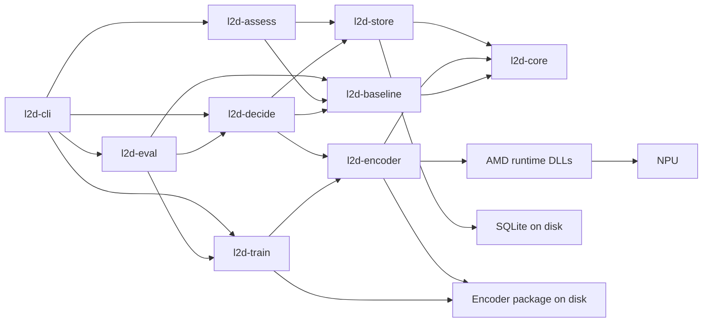
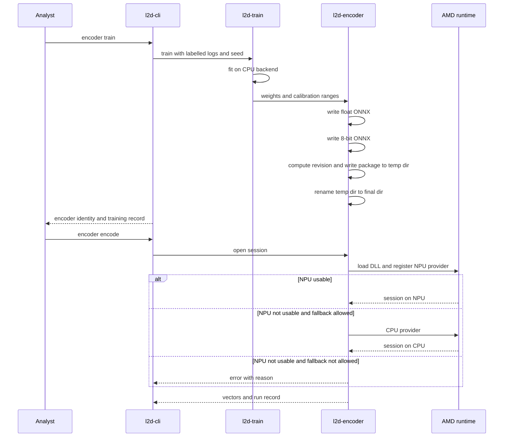
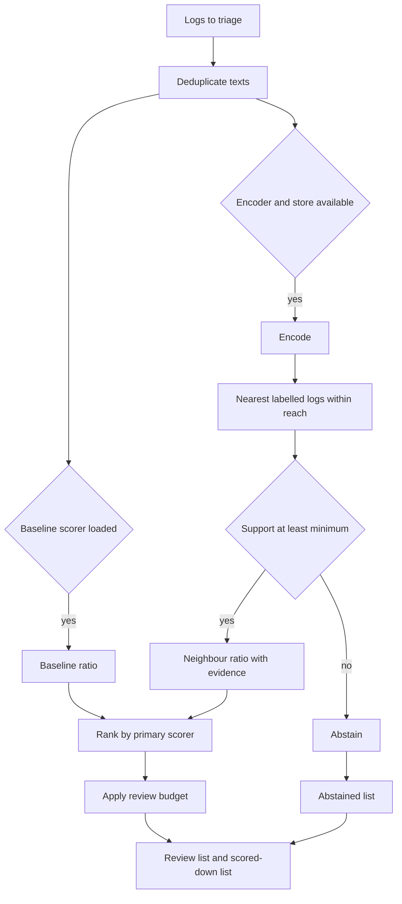

# Design Document: npu-log-decision

## Overview

**Purpose**: The Log Triage Tool (`l2d`) gives a forensic log analyst a bad/good ratio for every text log, ranks the logs, and scores down those that look good. It runs locally on a laptop.

**Users**: A log analyst works from the command line: load logs, fit or train scorers on labelled logs, store logs with vectors, triage new logs, compare groups of logs, assess vector sets, and evaluate quality and cost on a labelled dataset.

**Impact**: The repository holds no application code today. This design adds a Rust workspace with one command-line binary. It replaces the thesis notebooks as the working tool; `log2ml/` stays an untracked reference.

Two measured results shape the design. A general text-embedding model on the NPU reached 2.3 logs per second and separated attacks worse than character-level features (ROC AUC 0.79 against 0.91 to 0.96 on HTTP CSIC 2010). A small convolutional encoder with random weights reached about 36,700 logs per second on the same NPU. The design therefore has two scorers: a character-level baseline that needs no model runtime, and a small encoder trained on log text that runs on the NPU and feeds a nearest-outcome ratio.

### Goals
- A baseline bad/good ratio from character-level features that works without NPU or encoder.
- A byte-level convolutional encoder, trained in Rust, executed on the NPU at 1,000 or more logs per second, with a CPU fallback the analyst must allow.
- One embedded store for log text, labels and vectors, searchable by similarity, by text, and by both.
- Triage per log: ratio, evidence, abstention, ranking, review budget.
- Population-shift test, vector-set assessment, and an evaluation report with grouped splits.
- No Python at runtime, no network use.

### Non-Goals
- Language-model stages (for example explaining a decision); separate spec.
- Evaluation on AIT Log Data Set V2 or the thesis Sysmon data.
- Streaming ingestion, alerting, graphical interface.
- Bad/good share per source or time window.
- Acting on logs (blocking, deleting).
- Approximate vector indexes, BM25 ranking, GPU training by default, a long-running service process.
- Using the Venn Python package; its operations are re-implemented.

## Boundary Commitments

### This Spec Owns
- The `l2d` command-line contract: subcommands, options, exit codes, JSON output.
- Input adapters for line-based text logs, labelled CSV/JSONL, and HTTP CSIC 2010.
- The baseline scorer: character n-gram hashing and logistic regression, and its saved form.
- The encoder: architecture, training, ONNX writing, 8-bit quantization, package format, identity, and execution on NPU or CPU.
- The store schema and its search operations.
- The decision operations: nearest-outcome ratio with evidence and abstention, ranking and review budget, population-shift test.
- Vector-set assessment and evaluation reports.
- Run records for training, encoding and evaluation.

### Out of Boundary
- NPU driver installation and repair; the tool only reports state.
- Obtaining datasets; the analyst places them under `data/<dataset>/`.
- Obtaining AMD's runtime DLLs; the tool checks for them and names what is missing.
- Any language-model inference.
- Promotion of generated reports into `docs/`; the analyst does that and indexes them in `README.md`.

### Allowed Dependencies
- ONNX Runtime with AMD's Vitis AI provider, as native DLLs loaded at run time from `runtime/ryzenai/`.
- Rust crates: `ort` (features `load-dynamic`, `vitis`), `rusqlite` 0.32 (feature `bundled`; release 0.32 has no `fts5` feature, the bundled SQLite 3.46.0 is compiled with FTS5), `faer` 0.24, `linfa` 0.8 family (including `linfa-logistic`, `linfa-clustering`), `bhtsne` 0.5, `clap`, `serde`, `serde_json`, `csv`, `sha2`, `thiserror`, `windows` (process times, device query).
- `polars` for data frames, pinned to `=0.52.0` with default features off: facade features `lazy` and `ndarray` only, and the CSV and JSON readers enabled on `polars-io` directly. The facade's own `csv` and `json` features, and releases from 0.53 on, link network client crates and are not used. Other crates import Polars only through `l2d_core::polars`. Its cloud and HTTP features stay disabled. Numeric fits run outside Polars' thread pool so that results stay bit-identical.
- For zip input and result parts (requirement 13): `zip` 2.x with default features off and the feature `deflate` only, `flate2` (arrives with `zip`) for gzip entries, and the `polars-io` features `parquet` and `zstd`. Checked on 2026-11-12 in a scratch copy: the resolved lock file names no network crate. The check is repeated when the task adds them.
- No crate for the conformal calibration layer: the method is a few lines and is written in `l2d-decide` (owner decision of 2026-11-12, which replaces the adoption of `conformal-prediction`; task 1.18 removes the crate).
- `argmin` and `ndarray`, the optimizer and array types underneath `linfa-logistic`, used directly where `linfa-logistic` cannot take sparse input.
- `burn` 0.22.1 (confined to optional training module `l2d-train`).
- No crate that opens network connections may be added.
- No Python interpreter at runtime; development scripts in `uv` are permitted for offline model architecture exploration and static quantization.
- Dependency direction between workspace crates is fixed (see Architecture); a crate imports only from crates to its left.

### Revalidation Triggers
- Encoder architecture, input length, output dimension, or training objective changes.
- Encoder package format or identity scheme changes.
- Store schema changes, or more than one encoder identity per store.
- `Scorer` contract changes.
- A new AMD runtime release, NPU driver change, or `ort` feature-level change.
- CLI option, exit-code or JSON shape changes.
- Any change that adds a runtime prerequisite.

## Architecture

### Architecture Pattern & Boundary Map



**Architecture Integration**:
- Selected pattern: layered Cargo workspace of library crates plus one binary. Modules have zero async runtime; `l2d-store` runs synchronously on SQLite, and `l2d-encoder` dynamically loads ONNX Runtime.
- Dependency direction: `l2d-core` → `l2d-baseline`, `l2d-encoder`, `l2d-store` → `l2d-train`, `l2d-decide` → `l2d-assess` → `l2d-eval` → `l2d-cli`. A crate imports only from crates earlier in this order. `l2d-encoder`, `l2d-baseline` and `l2d-store` do not import each other.
- Domain boundaries: `l2d-encoder` owns package verification and execution; `l2d-train` trains weights and outputs package files. `l2d-store` owns the local SQLite database and exact in-memory SIMD vector search via `faer`.
- Data layer: Polars is the one tabular data layer. Log data is parsed with Polars, and tabular data crosses crate boundaries as Polars frames with the fixed schemas in "Data frames": logs, scores, calibration points, evaluation predictions. Typed structs remain for single values and identities (`InputSummary`, `EncoderIdentity`, `RunRecord`, errors). Frames are converted to `ndarray`, sparse rows or vector slices only at the numeric boundary (hashing, fitting, encoding, distance search). The store persists frames to SQLite and returns frames.
- Agnostic threat scoring: `l2d-baseline` separates routing context (path/method) from payload anomaly tokens; `l2d-decide` reports neighbor endpoint diversity and avoids false suppression; `l2d-eval` enforces strict grouped cross-validation to report cross-endpoint ROC AUC.
- Technology Stack:

| Layer | Choice / Version | Role in Feature | Notes |
|-------|------------------|-----------------|-------|
| CLI | Rust 1.98, `clap` 4, `serde_json` | Subcommands, JSON output, exit codes | Binary name `l2d` |
| Encoder execution | `ort` 2.0.0-rc.15, features `load-dynamic`, `vitis`, `std`, `ndarray`, one `api-NN` | Loads AMD's `onnxruntime.dll`; Vitis AI provider on NPU, CPU provider as fallback | `api-NN` fixed from DLL version |
| NPU runtime | AMD Ryzen AI 1.9 deployment DLLs in `runtime/ryzenai/` | ONNX Runtime plus Vitis AI provider | Untracked; from AMD deployment package |
| Data layer | `polars` (default features off; CSV, JSON, lazy, `ndarray` conversion) | Parsing of log data; frames between crates; grouping and joins in calibration, evaluation and reports | No cloud or HTTP features; lives in `l2d-core` |
| Calibration | own code in `l2d-decide` | Conformal label sets at a stated error rate | `conformal-prediction` is removed by task 1.18 |
| Storage | `rusqlite` 0.32 (`bundled`, which includes FTS5) + `faer` 0.24 | Logs, labels, FTS5 full-text, exact SIMD vector search | Single-file database (`stores/<name>.db`), zero async |
| Baseline Scorer | Character n-grams + L2 Logistic Regression via `faer` / `linfa` | Deterministic baseline ratio | Independent of NPU and ONNX runtime |
| Analysis | `linfa` 0.8, `faer` 0.24, `bhtsne` 0.5 | Vector-set assessment, MMD shift test, TwoNN | Pure-Rust numeric calculations |
| Optional Training | `burn` 0.22.1 (`Flex` CPU backend) | Offline neural model training | Confined to `l2d-train` |
| Build output | `CARGO_TARGET_DIR` = `D:\BuildArtifacts\cargo-target` | Build artifacts off the repo | Host convention |

## File Structure Plan

### Directory Structure
```
Cargo.toml                         # Workspace manifest, shared dependency versions
rust-toolchain.toml                # Pins the toolchain
crates/
├── l2d-core/src/
│   ├── lib.rs
│   ├── error.rs                   # L2dError, exit-code mapping
│   ├── types.rs                   # LogRecord, Label, InputSummary, EncoderIdentity, Ratio
│   ├── input.rs                   # InputAdapter trait, dedup, hashing of inputs
│   ├── adapters/lines.rs          # One log per line
│   ├── adapters/labelled.rs       # CSV/JSONL with configurable text, label, group columns
│   ├── adapters/csic2010.rs       # HTTP CSIC 2010 CSV
│   ├── paths.rs                   # Project directories: models, data, stores, runtime, reports
│   └── runrecord.rs               # RunRecord and its JSON form
├── l2d-baseline/src/
│   ├── lib.rs
│   ├── hashing.rs                 # Character 1-3 gram signed hashing with routing/payload isolation
│   ├── logreg.rs                  # Deterministic L2 logistic regression via faer/linfa
│   └── scorer.rs                  # BaselineScorer: fit, score, save, load
├── l2d-encoder/src/
│   ├── lib.rs
│   ├── arch.rs                    # EncoderArch: layer definitions, input length, dimension
│   ├── package.rs                 # EncoderPackage: artifact files, identity verification, revision hash
│   ├── bytes.rs                   # Text to fixed-length byte ids, truncation flag, table lookup
│   ├── runtime.rs                 # RuntimeFiles check, ort initialisation, NPU device and driver query
│   └── session.rs                 # EncoderSession: NPU or CPU execution via ort, placement evidence
├── l2d-train/src/                 # Optional / offline training module
│   ├── lib.rs
│   ├── model.rs                   # Burn module mirroring EncoderArch plus classifier layer
│   ├── trainer.rs                 # Training loop, seed, record, calibration activations
│   └── export.rs                  # Burn weights export to EncoderPackage files
├── l2d-store/src/
│   ├── lib.rs                     # Synchronous Store facade
│   ├── sqlite.rs                  # SQLite setup, FTS5 index, meta table (format 1; no migrations yet)
│   ├── vector.rs                  # In-memory exact SIMD vector search via faer
│   └── query.rs                   # Nearest, text (FTS5), combined, restricted searches
├── l2d-decide/src/
│   ├── lib.rs
│   ├── scorer.rs                  # Scorer trait, NeighbourScorer, baseline adapter
│   ├── evidence.rs                # Evidence tracking with endpoint diversity and anti-false-suppression
│   ├── triage.rs                  # Ranking, abstained list, review budget
│   ├── conformal.rs               # Label-conditional split conformal calibration over any scorer
│   └── shift.rs                   # RBF MMD permutation test
├── l2d-assess/src/
│   ├── lib.rs
│   ├── loss.rs                    # Explained variance, TwoNN, shortening effect, neighbour overlap
│   ├── cluster.rs                 # Silhouette, label separability overall and within group
│   ├── properties.rs              # Cosine distribution, norms, anisotropy, duplicates, dimension
│   ├── projection.rs              # t-SNE coordinates to CSV
│   └── compare.rs                 # Side-by-side report for two vector sets
├── l2d-eval/src/
│   ├── lib.rs
│   ├── split.rs                   # Grouped, deduplicated K-fold splits
│   ├── metrics.rs                 # ROC AUC, average precision, recall at budget
│   ├── cost.rs                    # Logs per second, time to first result, CPU seconds
│   └── report.rs                  # EvaluationReport to JSON and Markdown
└── l2d-cli/src/
    ├── main.rs                    # Argument parsing, dispatch, exit code
    ├── output.rs                  # Human and JSON rendering
    └── cmd/                       # One file per subcommand: ingest, baseline, encoder, store,
                                   # triage, shift, assess, eval, runtime
tests/                             # Workspace-level end-to-end tests with a small fixture dataset
tests/fixtures/mini-labelled.csv   # 200 synthetic labelled request lines
runtime/README.md                  # Which DLLs belong in runtime/ryzenai/ and where they come from
```

Runtime directories, all untracked: `models/encoders/<name>-<rev12>/`, `models/baselines/<name>-<rev12>/`, `models/calibrations/<name>-<rev12>/`, `stores/<name>.db`, `runtime/ryzenai/`, `runtime/cache/`, `reports/`.

### Modified Files
- `.gitignore` — add `/stores/`, `/runtime/ryzenai/`, `/runtime/cache/`, `/reports/`.
- `README.md` — layout table gains `crates/`, `runtime/`, `stores/`, `reports/`; spec status.

## System Flows

### Train, package and load the encoder



- A package becomes visible only through the final rename, so an interrupted run leaves earlier packages untouched (3.6).
- NPU registration uses `error_on_failure`; the CPU path is taken only with `--allow-cpu` (4.4).

### Triage



- The primary scorer is the encoder-based one when available, otherwise the baseline. Both ratios are reported when both exist (6.6).
- A log is abstained only by the encoder-based scorer. When that scorer is primary and abstains, the log goes to the abstained list even if a baseline ratio exists; the baseline ratio is still shown.

## Requirements Traceability

| Requirement | Summary | Components | Interfaces | Flows |
|-------------|---------|------------|------------|-------|
| 1.1 | Read text logs | LinesAdapter | `InputAdapter::read` | |
| 1.2 | Read labelled datasets | LabelledAdapter, Csic2010Adapter | `InputAdapter::read` | |
| 1.3 | Process duplicates once | Input dedup | `dedup` | Triage |
| 1.4 | Skip unreadable records | Input adapters | `InputSummary.skipped` | |
| 1.5 | Mark truncated logs | ByteCodec | `ByteCodec::encode_text` | |
| 1.6 | Record input identity | Input dedup | `InputSummary` | |
| 2.1 | Fit baseline | BaselineScorer | `BaselineScorer::fit` | |
| 2.2 | Ratio 0 to 1 | BaselineScorer | `Scorer::score` | Triage |
| 2.3 | Refuse too few labels | BaselineScorer | `FitError::TooFewLabels` | |
| 2.4 | Deterministic baseline | CharHasher, LogReg | fixed hash, fixed iteration order | |
| 2.5 | Works without NPU or encoder | BaselineScorer | no dependency on `l2d-encoder` | Triage |
| 3.1 | Fixed length and dimension | EncoderArch, Trainer | `EncoderArch` | Train |
| 3.2 | Encoder identity | EncoderPackage | `EncoderIdentity` | Train |
| 3.3 | Training record | Trainer | `RunRecord` | Train |
| 3.4 | Train without NPU | Trainer | Burn CPU backend | Train |
| 3.5 | Repeatable training | Trainer | seed, CPU backend | |
| 3.6 | Interrupted training is safe | EncoderPackage | atomic rename | Train |
| 4.1 | One vector per distinct text | EncoderSession | `EncoderSession::encode` | Train |
| 4.2 | 1,000 logs/s on NPU | EncoderSession | batch of 32, fixed shapes | |
| 4.3 | Encoding run record | EncoderSession, RuntimeFiles | `RunRecord`, `Placement` | Train |
| 4.4 | Fallback only when allowed | EncoderSession | `Device`, `EncoderError::NpuUnavailable` | Train |
| 4.5 | Mark CPU runs | EncoderSession | `RunRecord.device` | |
| 4.6 | NPU and CPU agree | EncoderSession, Quantizer | same 8-bit file on both | |
| 4.7 | Ready within 30 s | EncoderSession | on-disk provider cache | |
| 5.1 | Stored fields | Store | store rows frame, `Store::add_with` | |
| 5.2 | Text search | Store | `Store::text_search` | |
| 5.3 | Similarity search | Store | `Store::nearest` | Triage |
| 5.4 | Combined search | Store | `Store::nearest` with `Filter.contains` | |
| 5.5 | Restrict by label or source | Store | `Filter` | |
| 5.6 | Refuse identity mismatch | Store | `StoreError::IdentityMismatch` | |
| 5.7 | Persistent | Store | on-disk store | |
| 6.1 | Ratio from labelled logs | NeighbourScorer | `Scorer::score` | Triage |
| 6.2 | Evidence | NeighbourScorer | `Evidence` | Triage |
| 6.3 | Abstain below support | NeighbourScorer | `Decision::Abstain` | Triage |
| 6.4 | Ranking, abstained separate | Triage | `TriageResult` | Triage |
| 6.5 | Review budget | Triage | `TriageResult.review`, `.scored_down` | Triage |
| 6.6 | Name the scorer | Triage | `ScoredLog.by` | Triage |
| 6.7 | Never alter logs | Triage, Store | read-only inputs; store rows only added | |
| 7.1 | Statistic and p-value | ShiftTest | `shift_test` | |
| 7.2 | Group sizes, permutations | ShiftTest | `ShiftResult` | |
| 7.3 | Refuse small groups | ShiftTest | `ShiftError::GroupTooSmall` | |
| 7.4 | Repeatable with seed | ShiftTest | seeded permutations | |
| 7.5 | P-value wording | CLI output | `output.rs` text | |
| 8.1 | Information loss | LossAssessment | `assess_loss` | |
| 8.2 | Neighbour overlap with reference | LossAssessment | `neighbour_overlap` | |
| 8.3 | Clustering | ClusterAssessment | `assess_clusters` | |
| 8.4 | Separability within groups | ClusterAssessment | `separability_within_groups` | |
| 8.5 | Properties | PropertiesAssessment | `assess_properties` | |
| 8.6 | Projection file | Projection | `project_to_csv` | |
| 8.7 | Compare two encoders | Compare | `compare` | |
| 9.1 | Quality metrics per scorer | Metrics, Evaluator | `EvaluationReport.scorers` | |
| 9.2 | Distinct texts, grouped splits | GroupedSplit | `grouped_folds` | |
| 9.3 | Abstention rate | Evaluator | `ScorerResult.abstention_rate` | |
| 9.4 | Speed and energy proxy | Cost | `CostMeasure` | |
| 9.5 | Which scorer is better | Evaluator | `EvaluationReport.comparison` | |
| 9.6 | Report content | Report | `EvaluationReport` | |
| 9.7 | CSIC 2010 supported | Csic2010Adapter | `InputAdapter::read` | |
| 12.1 | Batch size from free memory | MemoryBudget | `MemoryBudget::plan` | |
| 12.2 | Analyst override | MemoryBudget, CLI | `--batch-rows`, `--memory-limit` | |
| 12.3 | Report memory and batch size | MemoryBudget | `BatchPlan` in `RunRecord.settings` and output | |
| 12.4 | Refuse when the smallest batch does not fit | MemoryBudget | `L2dError::Refused` | |
| 12.5 | Refuse whole-dataset operations over the limit | MemoryBudget | `MemoryBudget::require_whole` | |
| 12.6 | Results independent of batch size | Input adapters, scorers | global dedup state; order-preserving batches | |
| 12.7 | Shrink and grow between batches | MemoryBudget | `MemoryBudget::next_batch_rows` | |
| 12.8 | Record batch size changes | MemoryBudget | `BatchPlan.changes`, `min_rows_used`, `max_rows_used` | |
| 12.9 | Stay within the limit for the whole run | MemoryBudget | reserve check before every batch | |
| 13.1, 13.5 | Read archive entries without extracting; gzip entries | ZipInput | `ZipInput::open`, `ZipInput::batches` | |
| 13.2, 13.3, 13.4, 13.6 | Entry patterns, entry report, skipped and damaged entries | ZipInput | `ZipInputSettings.entries`, `EntryReport`, `EntrySkip` | |
| 13.7, 13.13 | Positions by entry and line; archive summary | ZipInput | `ArchiveSummary` | |
| 13.8, 13.9, 13.10 | Batches under the memory limit; record length limit; same results as unpacked | ZipInput, MemoryBudget | `Batcher`, `ZipInputSettings.max_record_bytes` | |
| 13.11 | Results written in parts | PartWriter | Parquet parts and manifest under the work directory | |
| 13.12 | Deduplication state within the limit | ZipInput, PartWriter | refusal (task 1.16), on-disk deduplication (task 1.17) | |
| 9.8 | Single-label groups reported separately | Evaluator, Metrics | `EvaluationReport.single_label_groups` | |
| 10.1 | No Python | whole workspace | native DLLs only | |
| 10.2 | No network | whole workspace | dependency rule | |
| 10.3 | Encoders under model directory | Paths, EncoderPackage | `ProjectPaths` | |
| 10.4 | Datasets from data directory or given path | Paths, input adapters | `ProjectPaths` | |
| 10.5 | Name missing items | Paths, RuntimeFiles | `L2dError::Missing` | |
| 10.6 | Non-zero exit and message | CLI | exit-code mapping | |
| 10.7 | Command line and JSON | CLI | `--json` | |
| 11.1 | Calibrate on logs not used for fitting | ConformalCalibrator | `ConformalCalibrator::fit` | |
| 11.2 | Label set at a chosen error rate | ConformalCalibrator | `ConformalCalibrator::predict`, `LabelSet` | Triage |
| 11.3 | Calibrate per label | ConformalCalibrator | per-label score lists | |
| 11.4 | Calibrate per group, state which was used | ConformalCalibrator | `Stratum` | |
| 11.5 | Refuse unsupported error rates | ConformalCalibrator | `CalibrationError::TooFewLogs` | |
| 11.6 | Scored down, review, uncertain, unlike | Triage | `TriageResult`, `AbstainReason` | Triage |
| 11.7 | Calibration or budget scored it down | Triage | `ScoredDownBy` | Triage |
| 11.8 | Achieved against chosen error rate | Evaluator | `ScorerResult.coverage` | |
| 11.9 | State the assumption | CLI output | `output.rs` text | |
| 11.10 | Repeatable label sets | ConformalCalibrator | no randomness, fixed tie rule | |

## Components and Interfaces

| Component | Crate | Intent | Req Coverage | Key Dependencies | Contracts |
|-----------|-------|--------|--------------|------------------|-----------|
| Input adapters and dedup | l2d-core | Read records, deduplicate, summarize | 1.1–1.4, 1.6, 9.7, 10.4 | `csv` (P1) | Service |
| ProjectPaths, RunRecord, errors | l2d-core | Locations, run records, error envelope | 3.3, 4.3, 10.3–10.6 | `sha2`, `serde` (P2) | Service |
| MemoryBudget | l2d-core | Batch size from free memory | 12.1–12.6 | `windows` (P1), `polars` batched readers (P0) | Service |
| BaselineScorer | l2d-baseline | Character-level ratio | 2.1–2.5 | l2d-core (P0) | Service, State |
| EncoderPackage, OnnxWriter, Quantizer | l2d-encoder | Encoder file format and identity | 3.1, 3.2, 3.6, 4.6 | `prost` (P1) | Service, State |
| EncoderSession, RuntimeFiles, ByteCodec | l2d-encoder | Encode on NPU or CPU | 1.5, 4.1–4.7 | `ort` and AMD DLLs (P0) | Service |
| Trainer | l2d-train | Train the encoder on CPU | 3.1, 3.3–3.5 | `burn` (P0), l2d-encoder (P0) | Batch |
| Store | l2d-store | Persist and search logs | 5.1–5.7, 6.7 | `rusqlite` (P0), `faer` (P0) | Service, State |
| Scorer, NeighbourScorer, Triage | l2d-decide | Ratio, evidence, abstention, ranking | 6.1–6.7 | l2d-store (P0), l2d-encoder (P0), l2d-baseline (P1) | Service |
| ConformalCalibrator | l2d-decide | Label sets at a stated error rate over any scorer | 11.1–11.7, 11.10 | l2d-core (P0) | Service, State |
| ShiftTest | l2d-decide | Population-shift test | 7.1–7.4 | none | Service |
| Assessments | l2d-assess | Vector-set measurements | 8.1–8.7 | `linfa`, `faer`, `bhtsne` (P1) | Service |
| Evaluator | l2d-eval | Quality and cost report | 9.1–9.6 | l2d-decide, l2d-train (P0) | Batch |
| CLI | l2d-cli | Commands, output, exit codes | 7.5, 10.6, 10.7 | `clap` (P1) | API |

### Core

#### Input adapters and dedup

| Field | Detail |
|-------|--------|
| Intent | Turn local files into deduplicated log records with a summary |
| Requirements | 1.1, 1.2, 1.3, 1.4, 1.6, 9.7, 10.4 |

**Responsibilities & Constraints**
- Parsing uses Polars. An adapter returns a logs frame (schema below) and an `InputSummary`. The `LogRecord` struct stays as the row view of that frame for code that handles one log at a time.
- Skipped records keep their position and reason (1.4): a validation pass over the raw records finds unreadable rows before Polars reads the accepted ones, so no row is dropped silently.
- Deduplication, occurrence counts, first positions and label conflicts are computed as frame operations, with rows kept in first-occurrence order.
- Read records in source order; never modify the source.
- Deduplicate by exact text; keep occurrence count and first position.
- When one text carries conflicting labels, keep the record as `Label::Unknown` and count it in `InputSummary.label_conflicts`.
- The CSIC 2010 adapter builds the text as method, URL, and body on a second line; the group key is the URL path alone, without method, host or query (decision of 2026-11-11). The method is left out because the dataset repeats the same payload as a GET query and as a POST body; grouping by path keeps both copies on one side of every split. Paths are not case-folded.

**Contracts**: Service [x]

```rust
pub enum Label { Good, Bad, Unknown }

pub struct LogRecord {
    pub text: String,
    pub label: Label,
    pub group: Option<String>,
    pub first_position: u64,
    pub occurrences: u32,
}

pub struct InputSummary {
    pub source_path: PathBuf,
    pub records: u64,
    pub distinct_texts: u64,
    pub content_sha256: String,
    pub skipped: Vec<SkippedRecord>,   // position and reason
    pub label_conflicts: u64,
}

pub trait InputAdapter {
    fn read(&self, path: &Path) -> Result<(LogsFrame, InputSummary), L2dError>;   // LogsFrame owns the Polars logs frame and gives LogRecord row views
}
```
- Preconditions: the path exists and is readable; otherwise `L2dError::Missing`.
- Postconditions: every returned text is unique; `records` equals the sum of occurrences plus skipped.

#### ZipInput and result parts

| Field | Detail |
|-------|--------|
| Intent | Read log records from a zip archive in batches under the memory limit, and write per-log results in parts on disk |
| Requirements | 13.1 to 13.13, 12.4, 12.6, 12.9 |

Added on 2026-11-12. Why this shape: Polars' streaming engine is not available (its facade feature links network crates), and neither Arrow nor Polars has a compressed in-memory buffer. So the tool keeps its own batches (MemoryBudget) and uses the disk as the spill. Memory holds one batch, the decompressor state and the deduplication state.

**Reading**
- `ZipInput` opens the archive, reads the central directory, and walks the entries in central-directory order. That order is the record order, so results do not depend on timing. Entries are read one at a time; reading entries in parallel is a later task (1.19).
- Each selected entry is read as a stream: decompressor, then the line splitting and byte-order-mark handling of the input adapters. Nothing is written to disk for reading. Zip64 archives are supported.
- Entry selection: glob patterns over the entry path (`--entry`, repeatable). Without a pattern every entry is tried.
- Text check on the first 8 KiB of an entry: a NUL byte or invalid UTF-8 marks the entry as not text.
- A gzip entry (by magic bytes, not by name) is read through a second decompressor. Every other nested archive (`.zip`, `.bz2`, `.xz`, `.tar`) is skipped and reported (owner decision).
- Maximum record length: default 1 MiB, option `--max-record-bytes`. It must not exceed the longest text the store accepts.
- The archive's content hash is SHA-256 over the archive file, computed in one streaming pass. Entry checksums are verified when an entry is read to its end.

**Batches and memory**
- Batches come from the `Batcher`. The cost of a batch is estimated from the uncompressed bytes of its records. Held for the whole run: the decompressor window and buffers, and the deduplication state.
- Deduplication state: a set of 128-bit text hashes with occurrence counts, held against the budget and grown batch by batch. Task 1.16 refuses when it no longer fits. Task 1.17 then writes records to parts partitioned by hash prefix and deduplicates each partition on its own, with results identical to the in-memory path.

**Result parts**
- An operation that produces per-log results for a batched input writes one Parquet part (zstd) per batch into a run directory, with a manifest that lists the parts, their row counts and their hashes.
- Location: `--work-dir`, default `<project>/work/<run>/` (ignored by git; owner decision).
- If the free disk space is less than the estimated size of the parts, the operation refuses before it starts and states both figures.

```rust
pub struct ZipInputSettings { pub entries: Vec<String>, pub max_record_bytes: u64 }

pub enum EntrySkip { NotText, Encrypted, UnsupportedMethod(u16), NestedArchive, NoPatternMatch, Damaged(String) }

pub struct EntryReport { pub path: String, pub records: u64, pub skipped: Option<EntrySkip> }

pub struct ArchiveSummary { pub input: InputSummary, pub entries: Vec<EntryReport> }

impl ZipInput {
    pub fn open(path: &Path, settings: &ZipInputSettings) -> Result<Self, L2dError>;
    // Yields frames of at most the planned batch rows; the position names entry and line.
    pub fn batches<'a>(&'a mut self, budget: &'a mut MemoryBudget) -> impl Iterator<Item = Result<LogsFrame, L2dError>> + 'a;
    pub fn finish(self) -> ArchiveSummary;
}
```
- This is a sketch; the implementing task settles the exact signatures and records deviations.

#### ProjectPaths, RunRecord, errors

| Field | Detail |
|-------|--------|
| Intent | Fixed locations, one run-record shape, one error envelope |
| Requirements | 3.3, 4.3, 10.3, 10.4, 10.5, 10.6 |

```rust
pub struct ProjectPaths { pub root: PathBuf }   // models/, data/, stores/, runtime/, reports/

pub struct EncoderIdentity { pub name: String, pub revision: String, pub dimension: u16 }

pub enum Device { Npu, Cpu }

pub struct RunRecord {
    pub kind: RunKind,                  // Train, Encode, Evaluate
    pub started_utc: String,
    pub duration_ms: u64,
    pub inputs: Vec<InputSummary>,
    pub settings: serde_json::Value,
    pub seed: Option<u64>,
    pub encoder: Option<EncoderIdentity>,
    pub device: Option<Device>,
    pub driver_version: Option<String>,
    pub logs_per_second: Option<f64>,
    pub placement: Option<Placement>,
}

pub enum L2dError {
    Missing { item: String, expected_at: PathBuf },
    InvalidInput { detail: String },
    Refused { reason: String },
    Runtime { detail: String },
}
```
- Exit codes: 0 success, 2 `InvalidInput`, 3 `Missing`, 4 `Refused`, 5 `Runtime`.
- Encoder packages are written only below `models/encoders/`; `EncoderPackage` rejects other targets.

#### MemoryBudget

| Field | Detail |
|-------|--------|
| Intent | Size batches to the free memory before a dataset is loaded |
| Requirements | 12.1, 12.2, 12.3, 12.4, 12.5, 12.6 |

**Responsibilities & Constraints**
- Lives in `l2d-core` (`memory.rs`). Reads free physical memory from the operating system (`GlobalMemoryStatusEx` through the `windows-sys` crate on the reference host) before loading; the reading is injectable for tests.
- The limit is kept in reality, not only on paper (12.9): a fixed process baseline of 32 MiB is taken off every limit; an analyst's limit at or below it is an invalid option value (exit 2). Each operation declares its cost (`BatchCost`: bytes per source byte, fixed bytes per row, fixed bytes per batch; parsing is 6.0, 500 and 4 MiB). Memory kept between batches (deduplicated rows at 200 bytes per row plus 2.6 times their estimated size, and skipped records) counts against the limit, and the run is refused when what is kept alone exceeds it. A test with a counting allocator (`tests/memory_limit.rs`) asserts that heap growth stays within the limit less the baseline for completed and refused runs; its large variant runs on request in release mode and must be re-run on any Polars change.
- The accounting is deliberately cautious: a read can be refused although it would have fitted (completed runs peak at about 0.2 to 0.8 of the limit). A deduplication that does not copy its state would narrow this; it is a recorded follow-up.
- Memory limit: the analyst's `--memory-limit` if given, otherwise a share of the free memory (default 0.5).
- Estimated bytes per row: from the file size and a sample of the first rows, times an expansion factor per operation (parsing, hashing, encoding) that each operation declares.
- Batch size: starts at the maximum batch size (the analyst's `--batch-rows` if given, otherwise 65,536 rows), reduced to `limit / bytes per row` when that is smaller, and never below the minimum (1,024 rows).
- Dynamic scaling: free memory is read again before every batch. When it is below the reserve (default: one quarter of the free memory observed at the start), the next batch is halved, down to the minimum. When it is above twice the reserve, the next batch is doubled, up to the maximum. If the minimum batch still does not fit, the operation stops with a refusal that states what was completed; it does not continue into an out-of-memory failure.
- The analyst is not expected to tune this: the defaults aim to leave memory for other programs on a busy host.
- Datasets are read in batches in file order: the validation pass cuts the batches from the source (read in 64 KiB pieces, hashed incrementally) and Polars parses each batch of accepted records; batches under 4 MiB are parsed on one thread. Deduplication keeps its state across batches, so frames and results do not depend on the batch size. The adapter contract is `read_from(source, &mut MemoryBudget) -> (LogsFrame, InputSummary, BatchPlan)`, with `read_with(path, budget)` and `read(path)` (default budget) provided.
- Every batch-size change is recorded with its cause (`below_reserve`, `recovered`, `free_too_small`, `limit_less_held`) and the memory that was available.
- Operations that need all rows at once (fitting the baseline, calibration, the shift test, pairwise assessments) call `require_whole` with their estimate and are refused before loading when it exceeds the limit.
- The plan (free memory observed, limit, bytes per row, batch size, whether the analyst overrode it) is printed and stored in the run record's settings.

**Contracts**: Service [x]

```rust
pub struct MemorySettings {
    pub memory_limit_bytes: Option<u64>,
    pub max_batch_rows: Option<u64>,     // --batch-rows
    pub free_share: f32,                 // default 0.5
    pub reserve_share: f32,              // default 0.25
}

pub struct BatchChange { pub at_row: u64, pub from_rows: u64, pub to_rows: u64, pub free_bytes: u64 }

pub struct BatchPlan {
    pub free_bytes: u64,
    pub limit_bytes: u64,
    pub reserve_bytes: u64,
    pub bytes_per_row: u64,
    pub batch_rows: u64,                 // first batch
    pub overridden: bool,
    pub changes: Vec<BatchChange>,
    pub min_rows_used: u64,
    pub max_rows_used: u64,
}

impl MemoryBudget {
    pub fn observe(settings: &MemorySettings) -> Result<Self, L2dError>;                       // reads free memory once
    pub fn plan(&self, total_rows_estimate: u64, bytes_per_row: u64) -> Result<BatchPlan, L2dError>;   // Refused when the minimum batch does not fit
    pub fn next_batch_rows(&mut self, plan: &mut BatchPlan, rows_done: u64) -> Result<u64, L2dError>; // re-reads free memory; halves or doubles; records the change
    pub fn require_whole(&self, estimated_bytes: u64, operation: &str) -> Result<(), L2dError>;       // Refused with estimate and limit
}
```

### Baseline

#### BaselineScorer

| Field | Detail |
|-------|--------|
| Intent | Bad/good ratio from character-level features |
| Requirements | 2.1, 2.2, 2.3, 2.4, 2.5 |

**Responsibilities & Constraints**
- Features: character 1-, 2- and 3-grams over the text's bytes, signed FNV-1a hashing into 65,536 buckets, L2-normalized sparse rows.
- Model: logistic regression with L2 penalty, fitted by full-batch L-BFGS with a fixed iteration cap and fixed row order. No randomness.
- Saved under `models/baselines/<name>-<rev12>/` as `weights.bin` (little-endian f64) and `baseline.json` (settings, bias, fit report, fitting inputs). The revision is the first 40 hex characters of SHA-256 over settings, weights and bias; `load` recomputes it and refuses a mismatch. Saving is atomic.
- A saved scorer records the content hash of every input it was fitted on. Saving the same revision again merges the inputs; it never drops one. A scorer with no recorded inputs has unknown provenance.
- A text with no features (for example strip mode on a request without query or body) scores the constant sigmoid of the bias and is flagged `no_features` in the Scores frame.
- Fitting needs all rows at once: the memory estimate is taken from a sample of hashed rows and checked with `require_whole` before the matrix is allocated.
- Defaults were chosen by measurement on CSIC 2010: tolerance 1e-3 (every routing mode converges in about 150 to 180 iterations) and an iteration cap of 1,000 as a safety limit. A capped or unconverged fit is visible in the fit report.
- Does not depend on `l2d-encoder` or `l2d-store`.

**Contracts**: Service [x] / State [x]

```rust
pub struct BaselineSettings {
    pub buckets: u32, pub ngram_max: u8, pub routing: RoutingMode,
    pub l2: f64, pub max_iter: u32, pub tolerance: f64,
}   // default 65_536 / 3 / Keep / 1.0 / 1_000 / 1e-3; every field is part of the revision

pub enum FitError {
    TooFewLabels { good: u64, bad: u64 },
    InvalidSettings { detail: String },
    Memory(L2dError),
    Solver(LogRegError),
}

impl BaselineScorer {
    pub fn fit(logs: &LogsFrame, inputs: &[InputSummary], settings: &BaselineSettings) -> Result<Self, FitError>;
    pub fn fit_with(logs: &LogsFrame, inputs: &[InputSummary], settings: &BaselineSettings, budget: &MemoryBudget)
        -> Result<Self, FitError>;                      // pass the budget used for reading, so the frame counts
    pub fn ratio(&self, text: &str) -> f32;             // 0.0..=1.0, higher is more likely bad
    pub fn score(&self, logs: &LogsFrame) -> Result<DataFrame, L2dError>;   // Scores frame, input row order
    pub fn save(&self, paths: &ProjectPaths, name: &str) -> Result<PathBuf, L2dError>;
    pub fn load(dir: &Path) -> Result<Self, L2dError>;
    pub fn load_under(paths: &ProjectPaths, dir: &Path) -> Result<Self, L2dError>;   // also checks the model directory
    pub fn was_fitted_on(&self, content_sha256: &str) -> bool;
    pub fn has_known_fitting_inputs(&self) -> bool;
    pub fn fit_report(&self) -> &BaselineFitReport;     // termination, iterations, gradient norm, counts
}
```
- Preconditions for `fit`: at least 10 distinct labelled logs and at least 5 of each label, else `TooFewLabels`. Rows labelled unknown are ignored.
- Invariant: equal frames (including row order) and settings give bit-equal weights on one build and machine.
- `LogReg` also accepts dense rows; `l2d-assess` reuses it for separability.

### Encoder

#### EncoderArch, EncoderPackage, OnnxWriter, Quantizer

| Field | Detail |
|-------|--------|
| Intent | Define the encoder and turn trained weights into an identified package |
| Requirements | 3.1, 3.2, 3.6, 4.6 |

**Responsibilities & Constraints**
- Architecture v1 (fixed): input 256 bytes; byte table 256 × 64; five convolution blocks with kernel 5 and ReLU (64→128, 128→128 stride 2, 128→256 stride 2, 256→256 stride 2, 256→256); global average pooling; linear 256→128. Output dimension 128. About one million parameters.
- The byte-table lookup runs on the CPU in `ByteCodec`. The ONNX graph takes `[32, 64, 1, 256]` float input and returns `[32, 128]`.
- `OnnxWriter` emits opset 17 with Conv, Relu, GlobalAveragePool, Flatten and Gemm.
- `Quantizer` emits the QDQ form: uint8 activations and int8 symmetric weights, per tensor, float scales; bias int32 with scale `input_scale × weight_scale`.
- Calibration ranges are the minimum and maximum of each activation over a calibration sample, supplied by the trainer.
- Package directory `models/encoders/<name>-<rev12>/` contains `encoder.json` (identity, architecture, quantization ranges), `table.bin`, `model.f32.onnx`, `model.int8.onnx`, `training-record.json`.
- Revision: SHA-256 over `model.int8.onnx`, `table.bin` and the architecture description, first 40 hex characters.
- A package is written to a temporary sibling directory and renamed into place.

**Contracts**: Service [x] / State [x]

```rust
pub struct Weights { pub table: Vec<f32>, pub layers: Vec<LayerWeights> }   // shapes checked against EncoderArch
pub struct CalibrationRanges { pub per_tensor: Vec<(f32, f32)> }

impl EncoderPackage {
    pub fn write(
        paths: &ProjectPaths, name: &str, arch: &EncoderArch,
        weights: &Weights, ranges: &CalibrationRanges, record: &RunRecord,
    ) -> Result<EncoderPackage, L2dError>;
    pub fn open(dir: &Path) -> Result<EncoderPackage, L2dError>;   // verifies revision against file hashes
    pub fn identity(&self) -> &EncoderIdentity;
}
```
- Postcondition of `open`: the stored revision equals the recomputed one, else `Refused`.

#### EncoderSession, RuntimeFiles, ByteCodec

| Field | Detail |
|-------|--------|
| Intent | Encode log texts on the NPU, or on the CPU when allowed |
| Requirements | 1.5, 4.1, 4.2, 4.3, 4.4, 4.5, 4.6, 4.7 |

**Responsibilities & Constraints**
- `RuntimeFiles::check` verifies the DLLs in `runtime/ryzenai/` against the list in `runtime/README.md` and names any missing file.
- The runtime is loaded with `ort` `load-dynamic` from that directory. The Vitis AI provider is registered with `error_on_failure`, cache directory `runtime/cache/`, cache key equal to the encoder revision, cache kept on disk.
- The environment variable for the provider's placement report is set in-process before the session is created; `Placement` is read from that report.
- NPU presence and driver version are read through a Windows device query.
- Texts are deduplicated by the caller; the session pads the last batch to 32 and drops padded outputs.
- Output vectors are L2-normalized on the CPU.
- The CPU path runs the same `model.int8.onnx` through the CPU provider of the same runtime.

**Dependencies**
- External: `ort`, AMD runtime DLLs — encoder execution (P0). Unproven from Rust; task 1 gates it.

**Contracts**: Service [x]

```rust
pub struct Placement { pub npu_nodes: u32, pub cpu_nodes: u32, pub source: PlacementSource }
pub enum PlacementSource { ProviderReport, Unavailable }

pub enum EncoderError {
    NpuUnavailable { reason: String },
    RuntimeMissing { file: String, expected_at: PathBuf },
    Failed { detail: String },
}

pub struct Encoded { pub vector: Vec<f32>, pub truncated: bool }

impl EncoderSession {
    pub fn open(pkg: &EncoderPackage, paths: &ProjectPaths, allow_cpu: bool) -> Result<Self, EncoderError>;
    pub fn device(&self) -> Device;
    pub fn encode(&mut self, texts: &[&str]) -> Result<Vec<Encoded>, EncoderError>;
    pub fn finish(self) -> RunRecord;      // identity, device, driver, logs per second, placement
}

impl ByteCodec {
    pub fn encode_text(text: &str) -> ([u8; 256], bool);   // bytes, truncated flag
}
```
- Preconditions: package revision verified; runtime files present.
- Postconditions: `encode` returns one entry per input text in input order, each of the identity's dimension.
- `open` with `allow_cpu = false` returns `NpuUnavailable` when the provider cannot be registered or no NPU nodes are placed.

**Implementation Notes**
- Integration: the `api-NN` feature of `ort` is chosen once from the DLL's reported version and recorded in the workspace manifest.
- Validation: a test opens the same package on NPU and CPU and checks cosine ≥ 0.99 per vector (4.6); a benchmark checks 1,000 logs/s over 10,000 logs (4.2) and readiness within 30 s (4.7).
- Risks: placement report may not regenerate on a warm cache; the first compile stores the counts in `runtime/cache/<revision>/placement.json` for reuse.

### Training

#### Trainer

| Field | Detail |
|-------|--------|
| Intent | Train the encoder on labelled logs and hand weights to the encoder crate |
| Requirements | 3.1, 3.3, 3.4, 3.5 |

**Contracts**: Batch [x]

- Trigger: `l2d encoder train --input <path> --adapter <name> --name <name> --seed <n>`.
- Input / validation: labelled records; refuses with fewer than 10 labelled or fewer than 5 of either label.
- Objective: binary cross-entropy on a classifier layer placed after the 128-dimension output; the classifier layer is discarded at export.
- Backend: Burn `Flex` CPU backend, seeded; batches in a seeded shuffled order. The `gpu` cargo feature switches to Vulkan and marks the record as GPU-trained.
- Output / destination: `Weights`, `CalibrationRanges` from 512 training texts, `RunRecord`; passed to `EncoderPackage::write`.
- Idempotency & recovery: nothing is written until training completes; an interrupted run leaves no package.

```rust
pub struct TrainSettings { pub epochs: u32, pub batch: u32, pub lr: f64, pub seed: u64, pub holdout_fraction: f32 }

pub fn train(records: &[LogRecord], arch: &EncoderArch, settings: &TrainSettings)
    -> Result<(Weights, CalibrationRanges, RunRecord), L2dError>;
```

**Implementation Notes**
- Risks: CPU training time is unmeasured; the first training task reports it.

### Storage

#### Store

| Field | Detail |
|-------|--------|
| Intent | Persist logs with vectors and answer text and similarity searches |
| Requirements | 5.1, 5.2, 5.3, 5.4, 5.5, 5.6, 5.7, 6.7 |

**Responsibilities & Constraints**
- One SQLite database `stores/<name>.db` holds one encoder identity, written to a `meta` table when the store is created.
- Rows are added; existing rows are never changed or removed by triage.
- Full-text search uses SQLite FTS5 for exact and containment queries.
- Vector search is exact squared L2 on normalized vectors, computed via `faer` SIMD matrix multiplication over stored vectors.
- Entirely synchronous; no async runtime or background database daemon.
- As built by task 1.8 (format 1): the FTS5 index is an external-content table over `logs.text` with the `trigram` tokenizer, kept in step by insert, delete and update triggers. Rows are never written with `INSERT OR REPLACE`, whose implicit delete would skip the trigger. A closed store is one file.
- Every row carries a finite vector of the store's dimension; a store cannot hold a log without a vector. A text with a NUL byte or longer than 8 MiB (`MAX_TEXT_BYTES`) is refused by row.
- Memory (requirement 12.9): an add holds 16 MiB plus 192 times the bytes of the longest text, counting the longest text indexed on the connection, and is refused up front when that does not fit. After an add that indexed a text over 16 KiB the store reopens its connection, because the text index keeps its hash table until the connection closes; an idle open store keeps at most 1 MiB (`Store::retained_bytes`). The caller's frame is not counted by the store.

**Dependencies**
- External: `rusqlite` 0.32 (`bundled`, which includes FTS5) and `faer` 0.24 (P0; added with the vector search in task 1.9).

**Contracts**: Service [x] / State [x]

```rust
// Rows go in as the store rows frame (see "Data frames"); the store computes `id` and `encoder_revision`.
pub fn log_id(source: &str, text: &str) -> String;   // SHA-256 of the 8-byte little-endian source length, the source, the text
pub fn rows_frame(logs: &LogsFrame, source: &str, vectors: &[f32], dimension: u16, truncated: &[bool]) -> Result<DataFrame, StoreError>;

pub struct AddReport { pub rows: u64, pub added: u64, pub repeated: u64, pub plan: BatchPlan, pub held_bytes: u64, pub longest_text_bytes: u64 }

pub enum StoreError {
    IdentityMismatch { store: EncoderIdentity, given: EncoderIdentity },
    Missing { name: String, expected_at: PathBuf },
    Exists { .. }, InvalidName { .. }, InvalidIdentity { .. }, InvalidRows { .. },
    Memory(L2dError),
    Failed { detail: String },
}

impl Store {
    pub fn create(paths: &ProjectPaths, name: &str, identity: &EncoderIdentity) -> Result<Self, StoreError>;
    pub fn open(paths: &ProjectPaths, name: &str) -> Result<Self, StoreError>;
    pub fn add(&mut self, rows: &DataFrame, identity: &EncoderIdentity) -> Result<AddReport, StoreError>;   // fresh budget; callers holding a frame use add_with
    pub fn add_with(&mut self, rows: &DataFrame, identity: &EncoderIdentity, budget: &mut MemoryBudget) -> Result<AddReport, StoreError>;
    pub fn require_identity(&self, given: &EncoderIdentity) -> Result<(), StoreError>;
    pub fn retained_bytes(&self) -> u64;
    pub fn len(&self) -> Result<u64, StoreError>;
}

// Task 1.9 defines reading rows back and searching; the shapes below are its starting point.
pub struct StoredLog { pub id: String, pub text: String, pub source: String, pub occurrences: u32, pub label: Label,
                       pub group: Option<String>, pub truncated: bool, pub vector: Vec<f32>, pub encoder_revision: String }
pub struct Filter { pub label: Option<Label>, pub source: Option<String>, pub contains: Vec<String> }
pub struct Hit { pub log: StoredLog, pub distance: f32 }

impl Store {
    pub fn nearest(&self, vector: &[f32], identity: &EncoderIdentity, k: usize, filter: &Filter)
        -> Result<Vec<Hit>, StoreError>;
    pub fn text_search(&self, filter: &Filter, limit: usize) -> Result<Vec<StoredLog>, StoreError>;
    pub fn vectors(&self, filter: &Filter) -> Result<Vec<StoredLog>, StoreError>;   // for assessment and shift
}
```
- Preconditions: `add` and `nearest` receive the identity of the encoder that produced the vectors; a difference from the store's identity returns `IdentityMismatch`.
- Invariant: `id` is unique; adding an existing `id` adds its occurrences and leaves text, label and vector unchanged. An add is one transaction; a failed add leaves the file as it was.
- For task 1.9: the trigram tokenizer folds case (Unicode, not only ASCII) and needs at least three characters, so case-exact matches need a second condition and shorter phrases a scan.

### Decisions

#### Scorer, NeighbourScorer, Triage

| Field | Detail |
|-------|--------|
| Intent | Ratio with evidence or abstention; ranking and review budget |
| Requirements | 6.1, 6.2, 6.3, 6.4, 6.5, 6.6, 6.7 |

**Responsibilities & Constraints**
- `NeighbourScorer`: for a vector, take the `k` nearest stored logs with a known label within squared distance `reach`; the ratio is the share of bad labels among them; abstain when fewer than `min_support` are found. Defaults: `k` 11, `min_support` 3, `reach` 0.5.
- Agnostic threat scoring: `Evidence` tracks whether nearest neighbors share the target log's `group` (endpoint) or span distinct endpoints. If nearest neighbors only match on a static benign endpoint without payload match, the score is not falsely suppressed.
- The baseline scorer is adapted to the same contract and never abstains.
- Triage ranks by the primary scorer, descending; ties keep input order.

**Contracts**: Service [x]

```rust
pub enum ScorerKind { Baseline, Neighbour }

pub struct Evidence {
    pub neighbours: Vec<Hit>,
    pub used: u32,
    pub same_group_count: u32,
    pub cross_group_count: u32,
}

pub enum Decision {
    Ratio { value: f32, evidence: Option<Evidence> },
    Abstain { found: u32, required: u32 },
}

pub trait Scorer {
    fn kind(&self) -> ScorerKind;
    fn score(&mut self, texts: &[&str]) -> Result<Vec<Decision>, L2dError>;
}

pub struct ScoredLog { pub text: String, pub occurrences: u32, pub by: Vec<(ScorerKind, Decision)> }

pub struct TriageResult {
    pub review: Vec<ScoredLog>,        // highest ratios, at most the budget
    pub scored_down: Vec<ScoredLog>,
    pub abstained: Vec<ScoredLog>,
}

pub fn triage(logs: &[LogRecord], scorers: &mut [Box<dyn Scorer>], primary: ScorerKind, budget: Option<usize>)
    -> Result<TriageResult, L2dError>;
```
- Postcondition: every input text appears in exactly one of the three lists.

#### ConformalCalibrator

| Field | Detail |
|-------|--------|
| Intent | Turn any scorer's ratio into a label set with a stated error rate |
| Requirements | 11.1, 11.2, 11.3, 11.4, 11.5, 11.6, 11.7, 11.10 |

**Responsibilities & Constraints**
- Method: split (inductive) conformal prediction, label-conditional. It works on the ratio of any `Scorer`, so it covers the baseline and the encoder-based scorer alike and needs no refit.
- Calibration input: ratios of labelled logs that were not used to fit the scorer. The caller holds out the calibration split. A saved scorer records the content hashes of its fitting inputs; calibration refuses an input whose content hash is among them. The evaluation harness calibrates on a part of each fold's fitting side that the scorer did not see.
- Nonconformity of a log for a label: `ratio` for good, `1 - ratio` for bad. A higher value means the log fits the label worse.
- P-value of a new log for a label: `(1 + number of calibration logs of that label with nonconformity >= the new log's) / (n_label + 1)`. Ties count as greater or equal; no randomization.
- Default error rate: 0.05; the analyst can set another per run.
- Label set at error rate `e`: every label whose p-value is greater than `e`. Sets: good, bad, both (uncertain), neither (unlike the calibration logs).
- Strata: per label always; per group in addition when the group holds at least `min_per_group` calibration logs of that label (default 100), otherwise the pooled list of that label. Each decision names its stratum.
- An error rate `e` is supported by a label's list only if `e >= 1 / (n_label + 1)`; otherwise `TooFewLogs` with the counts and the smallest supported rate.
- A scorer's own abstention passes through unchanged; it is not given a label set.
- Saved under `models/calibrations/<name>-<rev12>/`: scorer kind and revision, settings, and the sorted nonconformity lists per stratum. The revision is the SHA-256 of that content.
- The guarantee assumes new logs are exchangeable with the calibration logs of the same stratum. The tool states this in its output; `l2d shift` is the check the analyst can run.

**Build or adopt**
- Build (owner decision of 2026-11-12). Task 1.13 adopted the `conformal-prediction` crate and found that it contributes only the storage of a list's scores and the p-value count by linear scan, while linking `lean-agentic`, `rand` 0.8 and a second `ndarray` into the tool. Task 1.18 replaces it with own code in `conformal.rs` behind the unchanged contract below: the p-value count on the sorted lists the calibration already saves, by binary search. Label sets, revisions and saved calibrations must come out identical to those of 1.13.
- The task that introduces it confirms on the reference host that the crate links no network client and returns identical results on repeat, and records which parts of the method the crate covers.
- Calibration inputs are prepared as Polars frames (ratio, label, group) and grouped there.

**Contracts**: Service [x] / State [x]

```rust
pub enum LabelSet { Good, Bad, Both, Neither }
pub enum Stratum { Pooled, Group(String) }

// A group can have its own list for one label and the pooled list for the other
// (requirement 11.4 is per label), so each p-value names its own stratum.
pub struct Calibrated { pub set: LabelSet, pub p_good: f32, pub p_bad: f32, pub good_stratum: Stratum, pub bad_stratum: Stratum, pub error_rate: f32 }

pub struct CalibrationSettings { pub min_per_group: u32 }

// The row view of the calibration points frame (columns ratio, label, group); `points_frame` builds the frame.
pub struct CalibrationPoint { pub ratio: f32, pub label: Label, pub group: Option<String> }

pub enum CalibrationError {
    TooFewLogs { good: u64, bad: u64, smallest_supported: f32 },   // lengths of the shortest lists in use
    SameInputAsFitting { content_sha256: String },
    UnknownFittingInputs,
    UnknownCalibrationInputs,
    InvalidErrorRate { error_rate: f32 },
    InvalidRatio { ratio: f32 },
    InvalidPoints { detail: String },
    InvalidSettings { detail: String },
    OtherScorer { calibrated_kind: &'static str, calibrated_revision: String, kind: &'static str, revision: String },
    Memory(L2dError),
    Scorer(L2dError),
    Internal { detail: String },
}

impl ConformalCalibrator {
    // `points` is the calibration points frame. The caller checks the input hash against the
    // scorer's fitting inputs first (`require_held_out`); `fit_baseline` does both.
    pub fn fit(points: &DataFrame, scorer: ScorerKind, scorer_revision: &str, settings: &CalibrationSettings)
        -> Result<Self, CalibrationError>;
    pub fn fit_with(points: &DataFrame, scorer: ScorerKind, scorer_revision: &str, settings: &CalibrationSettings, budget: &MemoryBudget)
        -> Result<Self, CalibrationError>;
    pub fn fit_baseline(scorer: &BaselineScorer, logs: &LogsFrame, inputs: &[InputSummary], settings: &CalibrationSettings, budget: &MemoryBudget)
        -> Result<Self, CalibrationError>;
    pub fn predict(&self, ratio: f32, group: Option<&str>, error_rate: f32) -> Result<Calibrated, CalibrationError>;
    pub fn require_error_rate(&self, error_rate: f32) -> Result<(), CalibrationError>;
    pub fn require_scorer(&self, kind: ScorerKind, revision: &str) -> Result<(), CalibrationError>;
    pub fn save(&self, paths: &ProjectPaths, name: &str) -> Result<PathBuf, L2dError>;
    pub fn load(dir: &Path) -> Result<Self, L2dError>;
    pub fn load_under(paths: &ProjectPaths, dir: &Path) -> Result<Self, L2dError>;
}

pub enum AbstainReason { ScorerAbstained, Uncertain, UnlikeCalibration }
pub enum ScoredDownBy { Calibration, BudgetOnly }
```
- `ScoredLog` gains `calibrated: Option<Calibrated>`; entries of `TriageResult.abstained` carry an `AbstainReason`, entries of `scored_down` a `ScoredDownBy`.
- With a calibrated primary scorer, triage places a log by its label set: bad alone goes to the review ranking, good alone to `scored_down` (by calibration), both and neither to `abstained`. The review budget then applies to the review ranking; logs beyond it are `scored_down` by budget only.
- Evaluation reports, per label and per stratum, the share of test logs whose true label is missing from the set (achieved error rate) next to the chosen rate, and the share of each set kind (`ScorerResult.coverage`).

#### ShiftTest

| Field | Detail |
|-------|--------|
| Intent | Test whether two groups of vectors come from one population |
| Requirements | 7.1, 7.2, 7.3, 7.4 |

- Statistic: unbiased squared maximum mean discrepancy with a Gaussian kernel; bandwidth from the median pairwise distance of the pooled sample.
- P-value: `(1 + count of permuted statistics ≥ observed) / (1 + permutations)`; default 199 permutations; seeded.
- Groups larger than 2,000 are subsampled with the seed; the sizes used are reported.

```rust
pub struct ShiftResult { pub statistic: f64, pub p_value: f64, pub n_a: usize, pub n_b: usize, pub permutations: u32, pub seed: u64 }
pub enum ShiftError { GroupTooSmall { n_a: usize, n_b: usize, minimum: usize } }   // minimum 30

pub fn shift_test(a: &[Vec<f32>], b: &[Vec<f32>], permutations: u32, seed: u64) -> Result<ShiftResult, ShiftError>;
```

### Assessment and evaluation

#### Assessments

| Field | Detail |
|-------|--------|
| Intent | Reusable measurements of a vector set |
| Requirements | 8.1, 8.2, 8.3, 8.4, 8.5, 8.6, 8.7 |

- Input is a `VectorSet`: vectors with optional labels and group keys, from a store or from two encoders on the same logs.
- Pairwise measures run on a seeded sample of at most 5,000 vectors; the sample size is reported.

```rust
pub struct VectorSet { pub vectors: Vec<Vec<f32>>, pub labels: Option<Vec<Label>>, pub groups: Option<Vec<String>>, pub name: String }

pub struct LossReport { pub explained_variance: Vec<f32>, pub intrinsic_dimension: f32, pub shortened: Vec<ShortenedResult> }
pub struct ShortenedResult { pub dimension: u16, pub neighbour_overlap: f32, pub separability_auc: Option<f32> }
pub struct ClusterReport { pub k: u32, pub silhouette: f32, pub separability_auc: Option<f32>, pub within_group_auc: Option<f32> }
pub struct PropertiesReport { pub dimension: u16, pub cosine_quantiles: [f32; 5], pub norm_quantiles: [f32; 5], pub anisotropy: f32, pub duplicate_rate: f32 }

pub fn assess_loss(set: &VectorSet, shorten_to: &[u16], seed: u64) -> LossReport;                    // 8.1
pub fn neighbour_overlap(set: &VectorSet, reference: &VectorSet, k: usize) -> f32;                   // 8.2
pub fn assess_clusters(set: &VectorSet, k: u32, seed: u64) -> ClusterReport;                         // 8.3, 8.4
pub fn assess_properties(set: &VectorSet, seed: u64) -> PropertiesReport;                            // 8.5
pub fn project_to_csv(set: &VectorSet, out: &Path, seed: u64) -> Result<(), L2dError>;               // 8.6
pub fn compare(a: &VectorSet, b: &VectorSet, seed: u64) -> ComparisonReport;                         // 8.7
```
- Intrinsic dimension uses the TwoNN estimator. Anisotropy is the mean cosine between random pairs. Separability is the cross-validated ROC AUC of `LogReg` on the vectors. Within-group separability averages that AUC over groups holding at least 20 labelled logs with both labels, weighted by group size.
- The projection is t-SNE; the CSV has columns `x`, `y`, `label`, `group`.

#### Evaluator

| Field | Detail |
|-------|--------|
| Intent | Measure triage quality and cost on a labelled dataset |
| Requirements | 9.1, 9.2, 9.3, 9.4, 9.5, 9.6 |

**Contracts**: Batch [x]

- Trigger: `l2d eval --input <path> --adapter <name> --folds 5 --budget <n> --scorers baseline,neighbour`.
- Input / validation: labelled, deduplicated records with group keys; records without a group key form their own group.
- Splits: grouped K-fold; all logs of a group fall on one side. Each fold fits the baseline, optionally prepares the encoder and fills a temporary store on the fitting side only, then scores the test side. This enforces that testing strictly evaluates cross-endpoint generalization to prevent hardcoding training-set site topology.
- Metrics per scorer over the pooled test predictions: ROC AUC (overall and cross-endpoint), average precision, recall at budget, abstention rate, and the same metrics on non-abstained logs.
- Cost per scorer: logs per second, time to first result, process CPU seconds as the energy proxy.
- Output / destination: `reports/<date>-<dataset>-<encoder>.json` and `.md`.
- Idempotency & recovery: a rerun with the same seed overwrites the same report files; temporary stores are removed at the end.

```rust
pub struct ScorerResult {
    pub kind: ScorerKind,
    pub roc_auc: f64,
    pub cross_endpoint_roc_auc: f64,
    pub average_precision: f64,
    pub recall_at_budget: f64,
    pub abstention_rate: f64,
    pub roc_auc_non_abstained: f64,
    pub cost: CostMeasure,
}
pub struct CostMeasure { pub logs_per_second: f64, pub first_result_ms: u64, pub cpu_seconds: f64 }
pub struct EvaluationReport {
    pub date: String, pub dataset: InputSummary, pub encoder: Option<EncoderIdentity>,
    pub settings: serde_json::Value, pub scorers: Vec<ScorerResult>,
    pub comparison: Option<Comparison>,       // which scorer has the higher ROC AUC, and the difference
}
```

### Command line

#### CLI

| Field | Detail |
|-------|--------|
| Intent | One entry point for every operation |
| Requirements | 7.5, 10.6, 10.7 |

**Contracts**: API [x]

| Command | Purpose | Main options | Output |
|---------|---------|--------------|--------|
| `l2d ingest` | Read and summarize an input | `--input`, `--adapter` | `InputSummary` |
| `l2d baseline fit` / `score` | Fit or apply the baseline | `--input`, `--name` | identity or ratios |
| `l2d encoder train` / `encode` / `info` | Train, encode, show identity | `--seed`, `--allow-cpu` | identity, `RunRecord` |
| `l2d store add` / `search` | Fill and query a store | `--store`, `--text`, `--like`, `--label`, `--source`, `--k` | counts or hits |
| `l2d triage` | Rank logs | `--store`, `--baseline`, `--budget`, `--primary` | `TriageResult` |
| `l2d calibrate` | Calibrate a fitted scorer on held-out labelled logs | `--input`, `--baseline` or `--store`, `--name`, `--min-per-group` | calibration identity, counts per stratum |
| `l2d shift` | Compare two groups | `--a`, `--b`, `--permutations`, `--seed` | `ShiftResult` |
| `l2d assess` | Vector-set measurements | `--store`, `--kind`, `--reference`, `--out` | reports |
| `l2d eval` | Evaluation report | `--folds`, `--budget`, `--scorers` | `EvaluationReport` |
| `l2d runtime check` | Runtime files, NPU, driver | none | status list |

- Every command accepts `--json`; JSON goes to standard output, diagnostics to standard error.
- Errors print one line naming what failed and exit with the code from the error mapping.
- The human output of `l2d shift` states that the p-value is a test result and not the probability that a shift occurred.

## Data Models

### Domain Model
- **Log**: a distinct text with occurrences, label, optional group, source.
- **Encoder**: an immutable package identified by name, revision and dimension. Vectors are meaningful only together with their encoder identity.
- **Store**: logs with vectors of exactly one encoder identity.
- **Scorer**: produces a `Decision` per log. Baseline scorers are identified by name and revision.
- **Run record**: what was run, on what, with which settings and result.

Invariants: a vector is never compared with vectors of another identity; a package's revision always matches its files; triage never changes stored logs.

### Data frames

Frames exchanged between crates. Column names and types are fixed; a crate may add columns to a frame it owns but does not rename these.

| Frame | Columns | Produced by | Consumed by |
|-------|---------|-------------|-------------|
| Logs | `text` String, `label` String (`good`, `bad`, `unknown`), `group` String nullable, `first_position` UInt64, `occurrences` UInt32 | input adapters | baseline, encoder integration, store, triage, evaluation |
| Scores | `text` String, `scorer` String, `ratio` Float32 nullable, `abstained` Boolean, plus evidence columns owned by the scorer | scorers | triage, calibration, evaluation |
| Calibration points | `ratio` Float32, `label` String, `group` String nullable | evaluation harness, `l2d calibrate` | ConformalCalibrator |
| Store rows | `text` String, `source` String, `occurrences` UInt32, `label` String, `group` String nullable, `truncated` Boolean, `vector` List of Float32 (length = dimension) | `l2d_store::rows_frame`, encoder integration | Store |
| Predictions | `text`, `label`, `group`, `fold` UInt32, `scorer`, `ratio`, `label_set` String nullable | evaluation harness | metrics, reports |

- Row order is meaningful: the logs frame is in first-occurrence order, and frames derived from it keep that order unless a column says otherwise.
- Numeric code receives plain slices, `ndarray` arrays or sparse rows taken from these frames in row order; it never iterates a frame from several threads.

### Physical Data Model

Store table `logs`:

| Column | Type | Notes |
|--------|------|-------|
| `seq` | integer | Primary key; insertion order and the row id of the text index |
| `id` | text | Unique; see `log_id` |
| `text` | text | Indexed by the FTS5 external-content table `logs_fts` (`trigram` tokenizer) |
| `source` | text | Ordinary SQLite index |
| `occurrences` | integer, 1 to 4,294,967,295 | |
| `label` | text (`good`, `bad`, `unknown`) | Ordinary SQLite index |
| `group_key` | text, nullable | |
| `truncated` | integer, 0 or 1 | |
| `vector` | blob of little-endian float32, exactly 4 × dimension bytes | No approximate index |
| `encoder_revision` | text | Equals the store's identity |

Both tables are STRICT with CHECK constraints for the ranges above. The file carries `user_version` 1 and an application id.

Store table `meta`: one row with encoder name, revision, dimension, creation time, tool version.

Encoder package `encoder.json`: identity, architecture description, calibration ranges, quantization scheme, file hashes.

## Error Handling

### Error Strategy
- Validate at the edges: adapters, package open, store open, session open. Fail before doing work.
- Each crate has its own error enum; `l2d-cli` maps them to `L2dError` and an exit code.
- Partial input is tolerated (skipped records are counted); partial output is not (packages and reports appear only complete).

### Error Categories and Responses
- **Analyst errors** (exit 2): unknown adapter, bad option values, unreadable file format. The message names the option or the record position.
- **Missing items** (exit 3): encoder, baseline, store, dataset or runtime DLL not found. The message names the item and the expected location.
- **Refusals** (exit 4): too few labels, group too small, encoder identity mismatch, NPU unavailable without `--allow-cpu`, package revision mismatch. The message states the rule and the observed values.
- **Runtime failures** (exit 5): provider or database errors. The underlying message is included.

### Monitoring
Run records are written next to the artifact they describe (`training-record.json` in the package, encode and evaluation records in `reports/`). There is no background monitoring.

## Testing Strategy

### Unit Tests
- `CharHasher` and `LogReg`: equal input gives bit-equal weights; fitting refuses 9 labelled logs and a 10-log set with 4 of one label (2.3, 2.4).
- Input dedup: duplicate texts collapse with correct occurrence counts; an unreadable row is skipped and reported with its position; conflicting labels become unknown (1.3, 1.4).
- `ByteCodec`: a 300-byte text sets the truncated flag, a 256-byte text does not (1.5).
- `OnnxWriter` and `Quantizer`: the written float and 8-bit files load in the runtime's CPU provider; 8-bit outputs agree with float outputs at cosine ≥ 0.98 on 256 random inputs.
- `shift_test`: identical groups give p > 0.05, shifted Gaussians give p < 0.01, the same seed gives the same result, 29 logs are refused (7.1–7.4).
- `NeighbourScorer`: ratio equals the bad share of neighbours; abstains below minimum support (6.1–6.3).

### Integration Tests
- Package round trip: train on the fixture, write, reopen; a modified byte in `model.int8.onnx` makes `open` refuse (3.2).
- Interrupted training: a failure injected before the rename leaves the encoder directory unchanged (3.6).
- Store: add, restart, search by vector, by text, combined, and restricted by label; a vector from another identity is refused with both identities named (5.1–5.7).
- Triage on the fixture: every text lands in exactly one list; the budget is respected; stored rows are unchanged afterwards (6.4–6.7).
- Grouped split: no group key appears on both sides of any fold (9.2).

### End-to-End Tests
- `l2d baseline fit` then `l2d triage --json` on the fixture without runtime DLLs present: succeeds and names the baseline scorer (2.5).
- `l2d encoder train`, `store add`, `triage`, `eval` on the fixture with `--allow-cpu`: report files exist with dataset hash, encoder identity and both scorers (9.1, 9.6).
- `l2d encoder encode` without `--allow-cpu` and with the provider DLL removed: exit code 4 and a message naming the reason (4.4).
- `l2d store search` against a missing store: exit code 3 and the expected path (10.5).

### Performance and Hardware Tests (reference host, run on demand)
- NPU throughput: 10,000 distinct fixture-style logs at ≥ 1,000 logs/s; run record shows NPU placement (4.2, 4.3).
- NPU against CPU: cosine ≥ 0.99 for every vector of 1,000 logs (4.6).
- Readiness: second `EncoderSession::open` within 30 s (4.7).
- Evaluation on HTTP CSIC 2010 with grouped folds; the report states which scorer has the higher ROC AUC (9.5, 9.7).
- Repeatability: two training runs with one seed differ by at most 0.01 ROC AUC (3.5).

## Security Considerations
- Log data can contain attack payloads. The tool treats log text as data only: it is never executed, interpolated into shell commands, or used to build file paths.
- Text search terms are passed to the store as escaped literals, never concatenated into filter expressions unescaped.
- No network access; no crate with network features is linked (10.2).
- Runtime DLLs are loaded only from `runtime/ryzenai/` by absolute path.

## Performance & Scalability
- Encoding: fixed batch of 32, target ≥ 1,000 logs/s on the NPU (measured headroom: about 36,700 logs/s with random weights).
- Store: exact search over up to one million 128-dimension vectors (about 512 MB of vectors). Above that, an approximate index is a revalidation trigger.
- Pairwise assessments sample at most 5,000 vectors; the shift test at most 2,000 per group.
- Evaluation trains one encoder per fold; training time on the CPU backend is measured in the first training task and reported.

## Implementation Order Constraints
1. Runtime spike: load AMD's DLL from Rust, register the Vitis AI provider, run the spike's 8-bit model, read placement. Fix the `ort` feature level and the DLL list. If this fails, stop and return to design.
2. `rusqlite` with bundled SQLite builds on Windows (done in task 1.8).
3. `l2d-core` and `l2d-baseline` (no hardware dependency) can proceed in parallel with 1 and 2.
