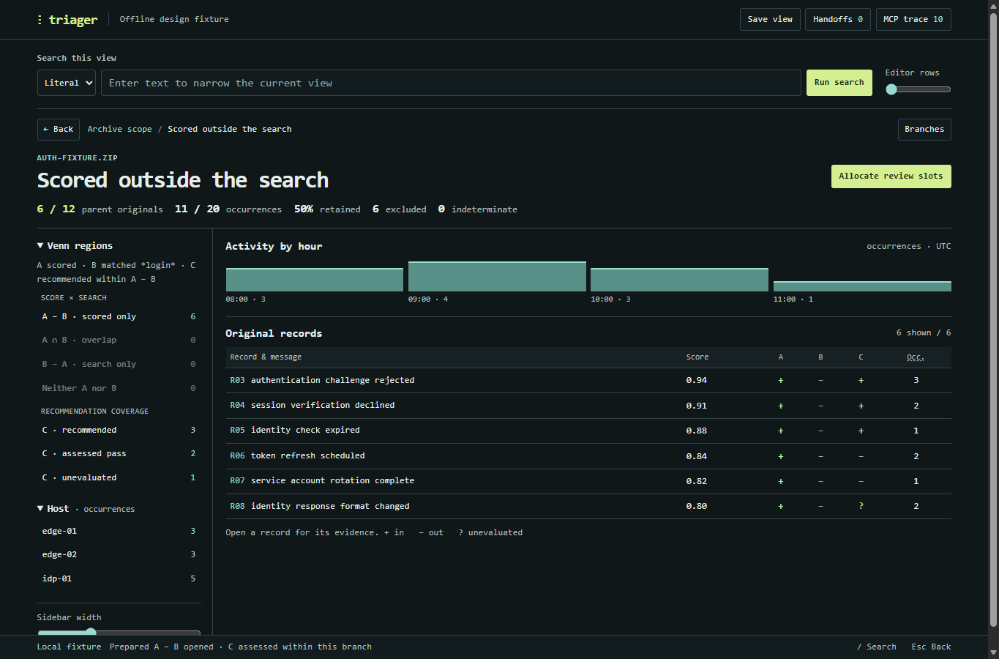

# Designing the analyst flow through MCP

An analyst opens a saved hunt and asks, **“Which high-scoring events did my search miss?”** They narrow the population to that difference, inspect why a case surfaced, then go back to see what the recommendation method could not assess. Either branch can be handed to a colleague. The work product is a sequence of inspectable decisions about a population. The terminal makes those decisions visible.

[Open the interactive workbench](prototype/index.html) · [Replay the example as tool calls](prototype/walkthrough.json) · [MCP contract](interface.md)

Run `l2d tui --demo --session hunt.json` to drive the same investigation in a terminal. Press `1` to open the difference shown below. The native PTY test follows the walkthrough and reopens the saved draft and final work set in separate processes. [Run the end-to-end cases](../../../docs/qualification/triager-e2e.md)

## The first workflow to drive

The small authentication fixture has 12 distinct originals and 20 occurrences. Its prepared evidence contains a score (A), a saved text filter (B) and a recommendation method assessed only on A minus B (C). It lets the reader follow every original through the reduction. The [archive-scale recipe](recipe.md) uses larger illustrative counts, and the [performance contract](performance.md) defines the actual scale test.

| What the analyst does | What the driver requests | What the analyst can establish |
|---|---|---|
| Open the investigation | `triager_open` and inspect the scope or saved view | Which source, interpretation and evidence revisions are in use. A saved candidate can be reopened before any review budget exists. |
| Select **A minus B** | `triager_compose(mode=view, scope=U, A − B)` | Six of the twelve distinct originals had high scores and missed the filter. The occurrences counter answers how often those originals appeared. |
| Compare C within those six | `triager_inspect` for regions on D, the A-minus-B view | Three recommended, two assessed passes and one unknown. Outside D, C had no coverage. |
| Open **recommended**, then a record | Derive the child under D, then `triager_inspect(view=evidence)` for that record | Three of **six** remain, or 50% of this step. Relative to the original twelve the share is 25%. Evidence identifies the original, its memberships and why C recommended it. |
| Return to D and open **unknown** | Revisit the retained D handle, then derive a sibling under D | One of the same six needs a different kind of review. The recommended branch is still available for comparison. |
| Save the unfinished hunt | `triager_save` a candidate and `triager_open` its receipt from a second client | The next analyst receives the same population, ancestry, evidence and coverage while all review slots remain unspent. |
| Allocate once from D | `triager_compose(mode=allocate)` with named pools, followed by inspect and save | Four distinct records enter the final work set in this fixture: two recommendations, one unknown and one audit from the two assessed passes. Each record retains the reason its slot was used. |

The operation names above describe the proposed application protocol. The browser mockup and headless driver use the same local fixture implementation. The screen opens on the prepared difference. Run the following from the repository root to play the checked workflow without the screen. For the visual walkthrough, open the linked HTML file directly in a browser. No installation is required for the browser view.

~~~sh
node .kiro/specs/triager/prototype/workflow.js
~~~

## What makes a drill-down reversible

Each view has a pinned **universe**, one **navigation parent** and the **input evidence revisions** its expression used. These answer different questions. For example, D and C may both contribute evidence to the recommended view. D alone supplies its parent denominator. A route to a wider population names that ancestor explicitly. The analyst can tell when a search has broadened.

For distinct originals and for occurrences independently, every reduction accounts for **included + excluded + unknown = the population of its parent**. Opening the unknown branch is an explicit query for indeterminate records. It does not turn them into negative evidence. Time and field choices first narrow matching occurrences and then report the distinct originals those occurrences represent. An empty result can still explain the parent and the operation that emptied it.

| Interaction | Durable investigation state | Client state |
|---|---|---|
| Compose or apply a filter | New immutable child with parent, evidence inputs, counts and operation. A sibling keeps its own handle. | Navigate to the child. Editing a draft alone leaves the current view intact. |
| Search the raw results | A saved search expression narrows the active view. A host predicate keeps only the matching occurrences of each original. A subsequent Venn drill inherits that occurrence scope. | Show the applied query above raw result rows, the matching histogram and fields. Press Enter for evidence or `r` for the full text. |
| Inspect a row | Read evidence under the active view and record handle. | Focus the row and open detail. Closing it restores selection and list position. |
| Read raw logs | Read the retained original text from the current region or ordered final set. | Open the selected original with `r`, page through long text and browse adjacent originals. Closing the reader returns to the initiating row or evidence detail. |
| Back, switch branch, resize a pane | Reuse the committed view. A redraw needs zero producer calls. | Restore the local navigation frame or change only pane geometry. |
| Start, cancel or complete a costly job | Bind the job to its starting parent and parameters. A successful late completion is available on that branch. Failure or cancellation preserves prior views. | Move focus only if the pending action and active parent still match. Otherwise show completion in status. |
| Save or hand off | Persist a candidate or final receipt, its lineage, coverage, ordering, producer revisions and any allocations. | The recipient may choose a different layout. A fresh client opens the saved state at its first page and can discover its retained ancestry. |

Population counts, sample rows and reviewed cases answer different questions. The default overview therefore shows the active scope and denominator before excerpts. Rows expose A/B/C and an explicit unknown reason. The allocation action names its source population even if the analyst is currently inspecting a narrow child. Confirming a security outcome remains a separate analyst action.

## From a drivable workflow to an SSH screen

1. **Drive the question through MCP.** Replay the same sequence against a stdio server when the Rust service is ready. Compare scope, parent, counts in both units, stable record IDs, unknown reasons, pool ordering and receipts. Substitute returned handles for the fixture aliases.
2. **Bind the screen to the verified operations.** Region controls, fields and histogram buckets derive views. Evidence reads are inspections. Search editing, scrolling within a loaded page and divider movement are local interactions. The terminal uses Taffy, Ratatui and Crossterm over the same Rust operations.
3. **Test an actual handoff.** Save D before allocation in MCP, reopen in the SSH TUI, explore both C branches and allocate once. Have MCP reopen the final receipt. The exact final IDs, ordered reasons and deferred counts must agree. Separately exercise empty, partial, stale-source and interrupted-job states, then verify the large-data performance gate.

The browser artifact demonstrates the interaction model with fixed synthetic evidence. Its shared in-memory store lasts for the page or headless process. Real ZIP access, model execution, durable storage, MCP transport and SSH behavior have their own implementation and acceptance tasks. [Task sequence](tasks.md) · [Terminal and layout design](design.md#terminal-workbench)
