# Embedding qualification: what is in the vectors the NPU encoder gives?

2026-11-14. Task 2.15 of the spec `npu-log-decision`, the gate before the
neighbour scorer, the linear head and the outlier ranking (tasks 2.8, 2.10,
2.11). Measured on the reference host (NPU driver 32.0.20102.4480, AMD Ryzen AI
1.9.0), with the published encoder of task 2.1 (`csic-science-2.1-099570ec739c`,
`payload` mode), through `EncoderSession` of task 2.6, NPU only. The vectors
were written by a Rust test; the pictures and figures come from Python scripts
run with `uv` (development only). Every figure below is in a named log under
`D:\BuildArtifacts\log2decision\task-2.15\logs\`.

## The answer

**Not noise, and not the one-point collapse of the spike model. But the vectors
are close to one-dimensional: they are a good/bad score spread along one curved
line, with little else in them.** Suitable with limits for the linear head; not
shown suitable for the neighbour scorer on endpoints the store has no texts of;
not checked for the outlier ranking, and the measurements give reasons to doubt
it. The limits are large enough that the owner should see them before task 2.8.

1. **Do different strings give different vectors?** Mostly yes, but they stay
   close. 12,079 distinct inputs give 11,052 distinct vectors; the same input
   always gives the same vector. The cosine similarity of two random CSIC inputs
   has median 0.83 and is above 0.99 for 9.0 % of the pairs (random unit vectors:
   median 0.00, none above 0.4). The spike model's collapse figure was 0.9998 for
   any two rows; here 0.36 % of the pairs are above it. The mean of all vectors
   has length 0.84, where one point would give 1 and no common direction 0.
2. **Do similar strings land near each other and unrelated ones apart?** Similar
   ones land near: one character changed 0.9994 to 0.9999, one value changed
   0.995 to 0.9998. Unrelated ones land apart only when one looks benign and the
   other does not. Two random texts: median 0.88. Two different benign requests:
   median 0.87. Two attacks of different classes in the same request: median
   0.91. An attack against its benign request: median 0.38. Over random CSIC
   pairs the rank correlation between text distance and vector distance is 0.19
   (within one endpoint 0.10); with random vectors it is -0.03.
3. **Do good and bad logs, and the endpoints, show structure?** Yes, both. Label:
   the 11 nearest texts share a text's label in 92 % of the cases (chance 52 %).
   Endpoint, among good texts only: 80 % (chance 20 %), although the encoder
   does not read the path. On the three endpoints the encoder was not fitted on,
   the linear head ranks at ROC AUC 0.939, but the neighbour scorer's quantity
   fails: every held-out good text has 9 or more bad texts among its 11 nearest
   fitting-side texts, ROC AUC 0.79 on distinct inputs and 0.55 on all texts.
4. **How many dimensions carry the variance?** Two. The first principal
   component holds 87.9 % of the variance, the first two 95.1 %, the first five
   99.4 %. Participation ratio 1.3 of 128 (random unit vectors: 126.7). No
   dimension is dead or constant, and the 8-bit output uses all 256 levels; the
   values vary, but together.

## What was measured

**The vectors.** `crates/l2d-encoder/tests/npu_embedding_export.rs` (on request)
opens `EncoderSession` on the published model, encodes CSIC's 25,608 distinct
texts and 72 probe texts, and writes little-endian `f32` files with a JSON-lines
file beside each: label, endpoint (URL path), both truncation flags, the text.
Log `export-1.log`: 33 of 35 nodes on the NPU, the first run through the Vitis AI
provider only (`QuantizeLinear`, `vitis_ai_ep_1`, `DequantizeLinear`); checksum
of the CSIC vectors 1570811.2676, the figure tasks 2.12 and 2.6 printed; a second
pass and the probes encoded one at a time differ in no bit. Flags: 4,821 texts
truncated, 9,681 longer than the input as a whole, 1,634 with an empty input.

**What the encoder reads.** In `payload` mode it reads what follows the first `?`
or line feed, at most 256 bytes. It does not read the method or the path. So
(`q0.log`):

- 25,608 distinct texts are 12,079 distinct inputs. 11,803 inputs have two
  texts, always the same payload once by GET and once by POST on one path. 28
  inputs carry both labels.
- 1,634 texts (1,614 bad, 20 good, on 1,623 paths) have no payload. Their input
  is empty and they all get one vector. Most of them are attacks in the path,
  which this encoder cannot see.
- **The analysis set** below is the first text of every distinct non-empty
  input: 12,078 texts, 4,812 good and 7,266 bad. Counting an input twice would
  make every text its own nearest neighbour.

**What the encoder was fitted on.** The training record in the package
(`models/science-2.1/record.json`) names the split. Three endpoints were held
out: `anadir.jsp`, `entrar.jsp`, `vaciar.jsp` (4,783 texts; 2,399 in the analysis
set, 840 good and 1,559 bad; 2,235 of them are `anadir.jsp`). Everything else is
the fitting side (20,825 texts; 9,679 in the analysis set): 15,713 training
texts, and 5,112 validation texts (`editar.jsp` and every fifth single-label
path) that chose the epoch (2 of 8). The scripts rebuild the split from the
paths and check the three counts against the record (`q3.log`). The labels were
the training target, so label structure on the fitting side shows that training
worked and nothing more. Label-independent evidence is: the probe texts, the
endpoint structure, and the held-out endpoints. The held-out endpoints are
still CSIC, the same application and the same attack tool.

**Baselines for scale.** (a) The same number of random unit vectors of dimension
128, put through the same code. (b) The same vectors with the classes shuffled.

**Ideas taken from log2ml.** From `Comparison_of_Encoder_Models.ipynb`: the 2-D
UMAP picture as the "scattered or clustered?" check, the silhouette score over
k-means clusters, the density plot of pairwise cosine similarities, and the PCA
scree and cumulative variance plots. From
`Log-Similarity-Clustering-FAISS.ipynb`: looking up exact string matches and
nearest neighbours by cosine and reading the neighbours as text. Added here: the
colouring by label, endpoint and held-out side, the probe texts, and the two
baselines.

## 1. Do different strings give different vectors?

Log `q1.log`.

| | CSIC vectors from the NPU | Random unit vectors |
|---|---:|---:|
| Distinct inputs / distinct vectors | 12,079 / 11,052 | |
| Inputs with more than one vector | 0 | |
| Cosine of random pairs (199,978), mean | 0.706 | 0.000 |
| median | 0.828 | 0.000 |
| 1st / 99th percentile | -0.093 / 0.9997 | -0.206 / 0.205 |
| Share of pairs above 0.99 | 9.0 % | 0 |
| Share of pairs above 0.9998 (spike model: any two rows) | 0.36 % | 0 |
| Length of the mean vector | 0.840 | 0.009 |
| Standard deviation per dimension, min / median / max | 0.010 / 0.045 / 0.084 | 0.087 / 0.088 / 0.090 |
| Total variance (sum over dimensions) | 0.295 | 1.000 |

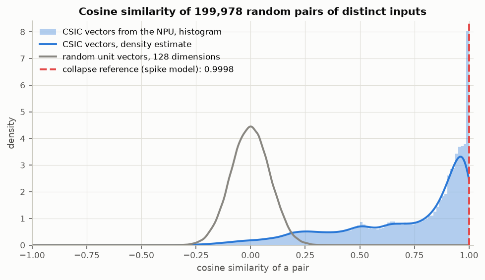

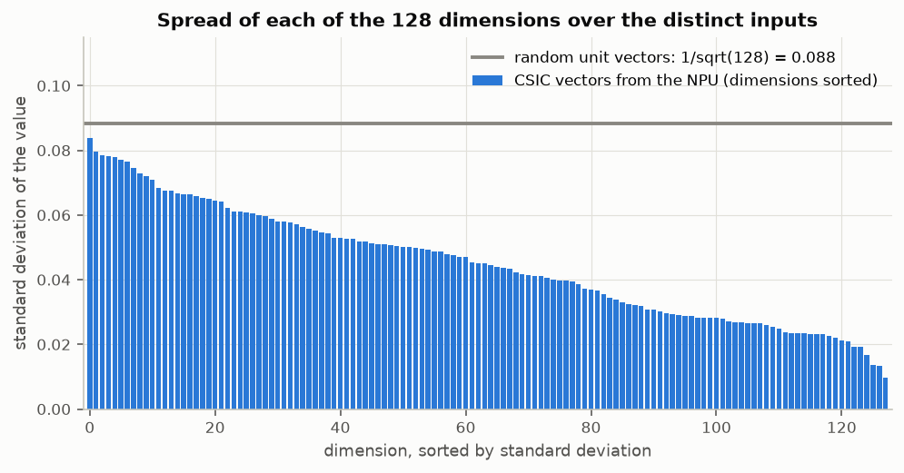

- This is not the spike model's failure. There every pair agreed to 0.9998; here
  the pairs spread from -0.36 to 1.
- The vectors are not spread over the sphere either. They share one direction
  (mean vector 0.84), and 70 % of the possible variance is missing.
- By label: two good texts, median 0.936; two bad texts, 0.931; a good and a bad
  text, 0.529. The spread is mostly the distance between the two labels.
- 381 vectors are shared by 1,408 different inputs. The examples are inputs that
  differ in digits only (`precio=178` and `precio=958`). A store keyed by vector
  would merge them; they have the same label in the examples seen.
- Duplicates: the three duplicated probes have bit-identical vectors, in one
  call and one at a time.

## 2. Do similar strings land near each other and unrelated ones apart?

Log `q2.log` (it lists all 72 probes and every pair).

### Probe pairs

The probes are CSIC-style requests written for this test: five benign requests,
exact duplicates, near duplicates, the same payload on other endpoints, eight
attack values (SQL injection, XSS, path traversal, command injection) each put
into three benign requests, 14 random texts, nine empty or very short texts, five
long texts. The grey band is where 90 % of random CSIC pairs fall.

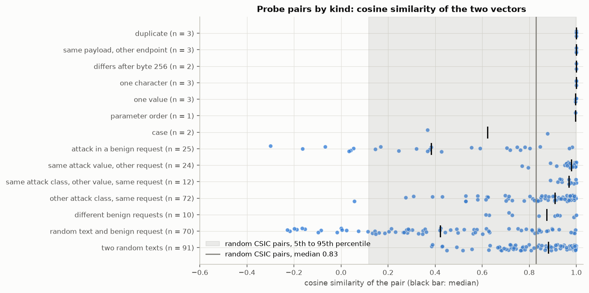

| Kind of pair | n | Cosine, min / median / max |
|---|---:|---|
| Exact duplicate | 3 | 1.0000 (identical bits) |
| Same payload, other endpoint or method | 3 | 1.0000 (identical bits) |
| Long texts that differ only after byte 256 | 2 | 1.0000 (identical bits) |
| One character changed | 3 | 0.9994 / 0.9998 / 0.9999 |
| One parameter value changed | 3 | 0.9954 / 0.9956 / 0.9998 |
| Parameter order changed | 1 | 0.9966 |
| Case changed (payload in upper case) | 2 | 0.367 / 0.622 / 0.878 |
| Attack put into a benign request, against that request | 25 | -0.300 / 0.383 / 0.982 |
| Same attack value in another request | 24 | 0.770 / 0.978 / 0.999 |
| Same attack class, other value, same request | 12 | 0.890 / 0.968 / 0.999 |
| Other attack class, same request | 72 | 0.056 / 0.908 / 0.998 |
| Two different benign requests | 10 | 0.615 / 0.875 / 0.999 |
| Random text against a benign request | 70 | -0.229 / 0.422 / 0.997 |
| Two random texts | 91 | 0.385 / 0.880 / 0.999 |
| Random CSIC pairs, for scale (`q1.log`) | 199,978 | 1st percentile -0.093, quartiles 0.512 / 0.828 / 0.947, 99th 0.9997 |

What this shows:

- **Similar near: yes.** Small edits stay above 0.995.
- **Unrelated apart: only across the benign/attack line.** An attack is far from
  its benign request (median 0.38) and so is random text (0.42). But two random
  texts are as close as two random CSIC texts (0.88), two different benign
  requests too (0.87), and attacks of different classes in one request are
  closer still (0.91). The vector says how far a payload is from normal CSIC
  traffic; it says little about what the payload is.
- **Three blind spots by construction.** The same payload on another endpoint or
  with another method is the same vector. A text without `?` and without a line
  feed has the empty input: the empty string, `a`, a plain syslog line and a path
  traversal in the path all get the vector of CSIC's 1,634 payload-less texts,
  bit for bit. Anything after byte 256 of the payload is not seen: a `DROP TABLE`
  after byte 256 gives the vector of the request without it; the same attack
  before byte 256 gives 0.748.
- **Case.** Upper-casing a benign payload moves it to the attack side (login
  0.37). All 11 nearest CSIC texts of both upper-case probes are bad.
- **One command-injection value is missed.** `49|ping -c 3 127.0.0.1` stays at
  0.97 to 0.98 of the benign request in two of three requests, and 9, 2 and 3 of
  its 11 nearest CSIC texts are bad. `49;cat /etc/passwd` stays at 0.80 to 0.85
  in two requests but has 9 to 11 bad neighbours. The SQL injection, XSS and traversal probes
  have 11 bad texts among 11 in all 18 cases; the benign probes 0 to 3.
- **Every probe has a CSIC text close by.** The nearest CSIC vector is at cosine
  0.980 or more for all 72 probes, random bytes included. Nothing lands in an
  empty region.

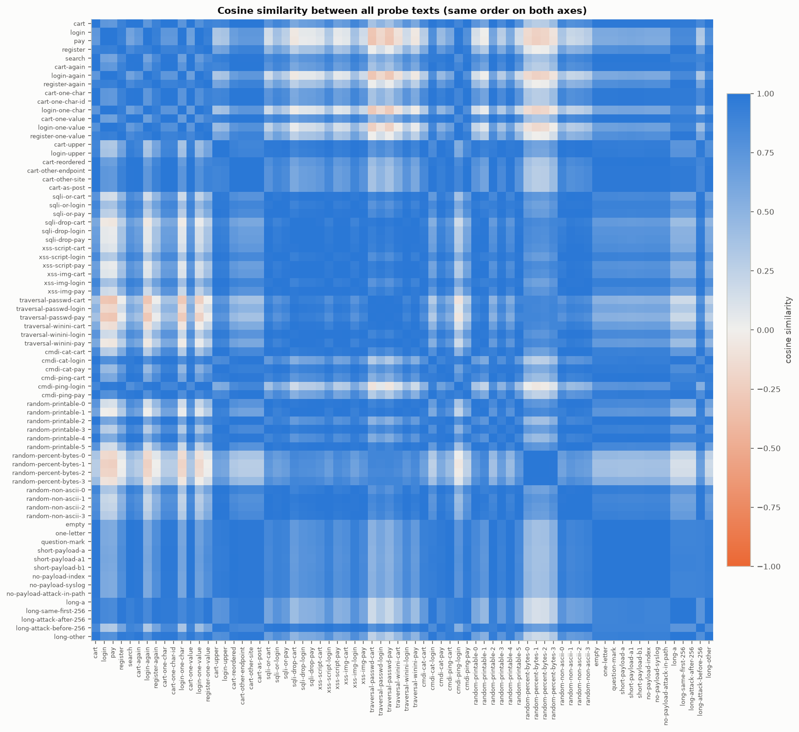

### Text distance against vector distance

4,000 random pairs of the analysis set and 4,000 pairs within one endpoint.
Text distance: Jaccard distance of the byte 3-grams of the two inputs, and edit
distance divided by the longer length. Vector distance: 1 minus cosine.

| Spearman rank correlation | Random pairs | Pairs within one endpoint |
|---|---:|---:|
| 3-gram Jaccard distance | 0.189 | 0.104 |
| Edit distance | 0.176 | 0.169 |
| The same with random unit vectors | -0.032 / -0.028 | -0.015 / 0.003 |
| Jaccard, two good texts only | 0.641 (n 616) | 0.274 (n 674) |
| Jaccard, two bad texts only | 0.249 (n 1,417) | 0.193 (n 1,417) |
| Jaccard, one good and one bad | 0.143 (n 1,966) | -0.023 (n 1,909) |

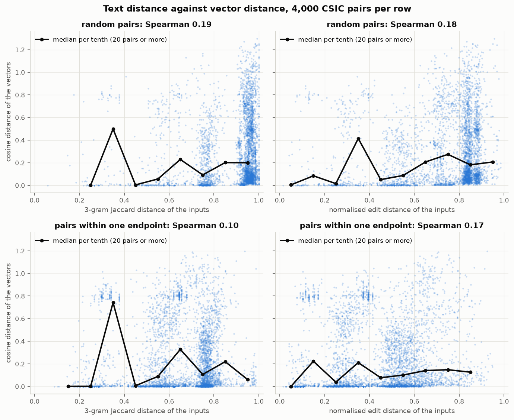

The relation is there and it is weak. Among good texts of different endpoints it
is clear (0.64): the endpoints' forms differ and so do their vectors. Within one
endpoint, and across the labels, text distance tells little about vector
distance. The picture shows why: most pairs sit at a vector distance near 0
whatever their text distance, and a band near 0.8 holds the good/bad pairs.

### Nearest neighbours as text

From `q2.log`; `localhost:8080` removed, long texts cut.

| Query | Nearest CSIC texts (cosine, label) |
|---|---|
| good, held-out: `anadir.jsp?id=3&nombre=Vino+Rioja&precio=100&cantidad=55&B1=...` | 1.000 good `...Vino+Rioja&precio=100&cantidad=35...`; 1.000 good `...cantidad=25...`; 1.000 good `...cantidad=2...` |
| bad, held-out: `anadir.jsp?...&cantidad=';+DROP+TABLE+usuarios;+SELECT+*...` | 0.999 bad `anadir.jsp?id=1&nombre=<!--#include+file="archivo_secreto"+-->...`; 0.999 bad `autenticar.jsp?...login=<!--#include...`; 0.999 bad `autenticar.jsp?...login=';+DROP+TABLE+usuarios...` |
| bad, training: `autenticar.jsp?...remember=on<!--#exec+cmd="rm+-rf+/;cat+/etc/passwd"+-->` | 1.000 bad the same attack, other login; 0.998 bad `...remember=','0','0');waitfor+delay+'0:0:15';--`; 0.997 bad the same `waitfor` |
| probe, benign: `/search?q=red+shoes&page=2&sort=price` | 1.000 good `entrar.jsp?errorMsg=Credenciales+incorrectas`; 1.000 good `vaciar.jsp?B2=Vaciar+carrito`; 0.999 bad `/?OpenServer` |
| probe, random printable text | 0.999 bad `anadir.jsp?...cantidad='+DELETE+FROM+USERS...`; 0.999 bad `...cantidad=82'INJECTED_PARAM...` |
| probe, benign and long (2,000 bytes) | 0.999 bad `editar.jsp?modo=+&login=honda...`; 0.999 good `registro.jsp?...`; 0.998 good `registro.jsp?...` |

The neighbours of a benign request are the same request with other values. The
neighbours of an attack are attacks, but not the same kind: a `DROP TABLE` sits
at 0.999 from a server-side include. A request the application does not have
(`/search`) lands at 1.000 among short benign requests of other endpoints.

## 3. Do good and bad logs, and the endpoints, show structure?

Log `q3.log`. The analysis set has eight endpoints with both labels and three
bad texts on two other paths.

### Projections

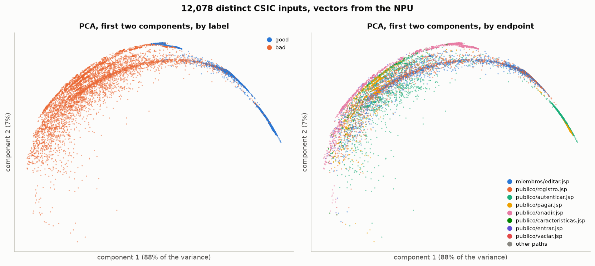

The first two principal components keep 95.1 % of the variance, so this picture
is nearly the whole geometry: one arc, good texts at one end, bad texts at the
other. `editar.jsp` and `registro.jsp` take the same form and lie on each other.
The held-out `anadir.jsp` sits at the top of the arc: its good texts form the
short blue stretch there, between the fitting side's good end and bad end.

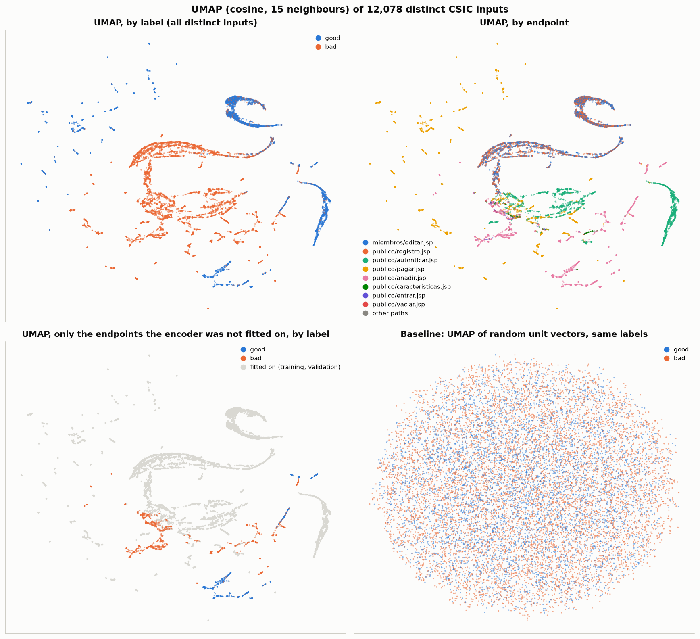

UMAP pulls the arc apart into strands. Good and bad are on different strands,
the endpoints mostly on their own. Bottom left: only the held-out endpoints are
coloured. Their good and bad texts are apart from each other, and both lie away
from the fitting side's good strands. Bottom right: random unit vectors with the
same labels give one round cloud.

### k-means, silhouette, nearest neighbours

k-means on the analysis set, 10 starts, against label (two classes) and against
endpoint (eight classes). "Shuffled" is the same clustering against shuffled
classes; clusters of random unit vectors score 0.00 on every row.

| k-means | Adjusted Rand | NMI | Purity | Shuffled: adjusted Rand / NMI / purity |
|---|---:|---:|---:|---|
| k = 2 against label | 0.596 | 0.477 | 0.886 | 0.000 / 0.000 / 0.602 |
| k = 2 against label, held-out texts | 0.119 | 0.103 | 0.708 | 0.001 / 0.000 / 0.650 |
| k = 8 against label | 0.194 | 0.349 | 0.919 | 0.000 / 0.000 / 0.602 |
| k = 8 against label, held-out texts | 0.204 | 0.367 | 0.841 | 0.003 / 0.000 / 0.650 |
| k = 8 against endpoint | 0.254 | 0.381 | 0.500 | 0.000 / 0.001 / 0.210 |
| k = 8 against endpoint, good texts only | 0.582 | 0.744 | 0.594 | 0.000 / 0.002 / 0.215 |
| k = 20 against endpoint, good texts only | 0.652 | 0.762 | 0.751 | 0.000 / 0.003 / 0.223 |

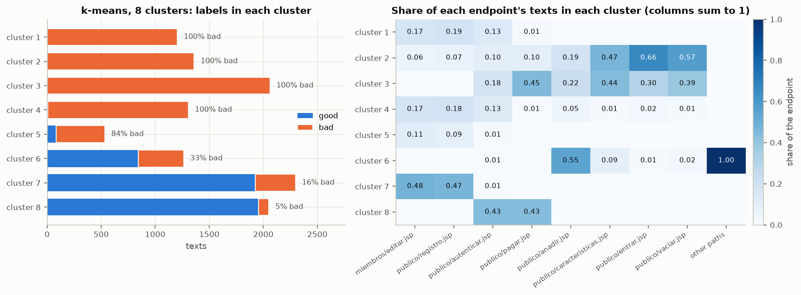

| Silhouette, cosine distance | Value | Classes shuffled |
|---|---:|---:|
| By label (sample of 6,000) | 0.648 | -0.001 |
| By label, fitting side (sample of 6,000) | 0.740 | 0.001 |
| By label, held-out texts (2,399) | 0.452 | 0.006 |
| By endpoint, good texts only (4,812) | 0.251 | -0.722 |
| By endpoint, bad texts only (sample of 6,000) | -0.194 | -0.057 |
| By endpoint, all texts (sample of 6,000) | -0.332 | -0.200 |
| By k-means cluster, k = 8 (sample of 6,000) | 0.670 | -0.026 |
| By label, random unit vectors | 0.000 | 0.000 |

| Share of the 11 nearest other texts with the text's own class | Vectors from the NPU | Classes shuffled | Random unit vectors |
|---|---:|---:|---:|
| Label, all (12,078) | 0.922 | 0.525 | 0.521 |
| Label, held-out texts among themselves (2,399) | 0.956 | 0.550 | 0.547 |
| Endpoint, the eight endpoints (12,075) | 0.757 | 0.195 | 0.192 |
| Endpoint, good texts only (4,812) | 0.798 | 0.204 | 0.202 |
| Endpoint, bad texts only (7,263) | 0.731 | 0.185 | 0.185 |

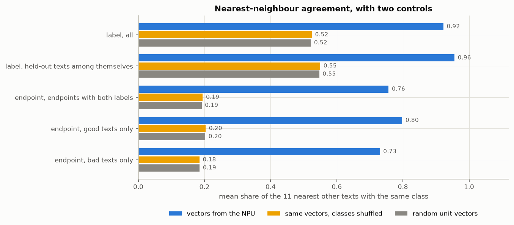

- **Label structure is strong, and it is partly the training.** It is weaker on
  the held-out endpoints (silhouette 0.45 against 0.74) but far from the
  controls there too.
- **Endpoint structure is real and label-independent.** Among good texts the
  neighbours are of the same endpoint 80 % of the time against 20 % by chance,
  although the encoder never reads the path. It reads the parameter names, and
  those differ by form. Among bad texts the endpoints overlap more, and as
  groups they are not compact (negative silhouette): an attack pulls a text
  away from its endpoint's good texts and towards other attacks.

### The held-out endpoints against the fitting side

This is the case the neighbour scorer and the linear head are for: texts of
endpoints not seen before, scored against stored texts of other endpoints.

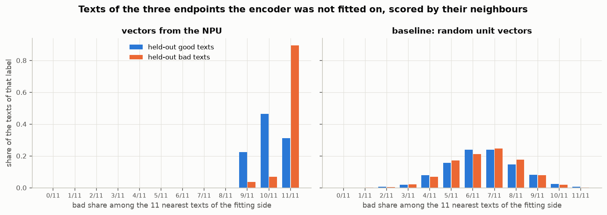

| 2,399 held-out texts against 9,679 fitting-side texts | ROC AUC |
|---|---:|
| Bad share among the 11 nearest fitting-side texts | 0.791 |
| the same, fitting labels shuffled, 20 times | mean 0.491, 0.150 to 0.921 |
| the same, random unit vectors | 0.507 |
| the same, `anadir.jsp` alone (2,235) | 0.784 |
| the same, all 4,783 held-out texts against all 20,825, repeated inputs counted | 0.551 |
| Linear head (logistic regression, C = 1) fitted on the fitting side | 0.939 |
| the head, fitting labels shuffled, 20 times | mean 0.568, 0.052 to 0.914 |
| the head, random unit vectors | 0.511 |
| First principal component of the fitting side alone, as the score | 0.936 |
| Neighbours on the first 1 / 2 / 5 / 10 principal components only | 0.782 / 0.811 / 0.613 / 0.775 |

- **Every held-out good text has at least 9 bad texts among its 11 nearest
  fitting-side texts** (mean bad share 0.917; held-out bad texts 0.987). A
  majority vote calls all 2,399 texts bad: all bad texts found, no good text
  kept. A ranking is left (0.79), because bad texts reach 11 of 11 more often.
  With every input counted as often as CSIC has it (mostly twice), the 11
  neighbours are about six inputs, the ties grow and the figure falls to 0.55.
  The science gate recorded 0.592 for this model and split, and 0.899 as the
  mean of 15 other models over five folds.
- **The linear head ranks the held-out texts well (0.939), and the first
  principal component alone does as well (0.936).** The head adds nothing to
  the main direction of the vectors. The science gate recorded 0.938.
- **The shuffled controls do not stay at 0.5.** A head fitted on shuffled labels
  scored further than 0.2 from 0.5 in 14 of 20 runs (from 0.052 to 0.914). With
  one dominant direction, a head fitted on noise still lands on that direction
  with a random sign. On such vectors a good figure from a head is weak evidence
  that the labels it was fitted on mean anything.

## 4. How many dimensions carry the variance?

Log `q4.log`.

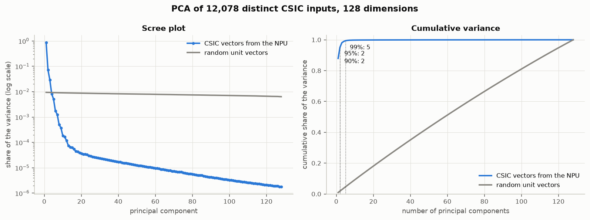

| | Components for 90 / 95 / 99 % | Participation ratio | First component |
|---|---|---:|---:|
| CSIC vectors from the NPU (12,078) | 2 / 2 / 5 | 1.3 | 87.9 % |
| Good texts only (4,812) | 1 / 2 / 3 | 1.2 | 90.1 % |
| Bad texts only (7,266) | 3 / 3 / 7 | 1.6 | 78.3 % |
| Held-out texts only (2,399) | 1 / 2 / 3 | 1.1 | 94.5 % |
| All 25,608 texts, repeated inputs counted | 2 / 3 / 5 | 1.3 | 86.0 % |
| Random unit vectors (12,078) | 113 / 121 / 127 | 126.7 | 0.9 % |

- Three components hold more than 1 % of the variance each, seven more than
  0.1 %. The smallest eigenvalue is 2.0e-6 of the largest.
- No dimension is constant, none has a standard deviation below 0.001, one is
  below 0.01. The 128 values all move; they move together.
- The 8-bit output can be read back from the unit vectors: in every one of the
  12,078 vectors all values are whole multiples of the vector's smallest gap.
  On that grid the levels run from -133 to 122, all 256 levels occur, a
  dimension uses 22 to 167 distinct levels (median 87), and one vector has 67 to
  103 distinct values. The output's length before normalising is 311 to 686
  steps (median 391). Quantisation is not what limits the vectors.

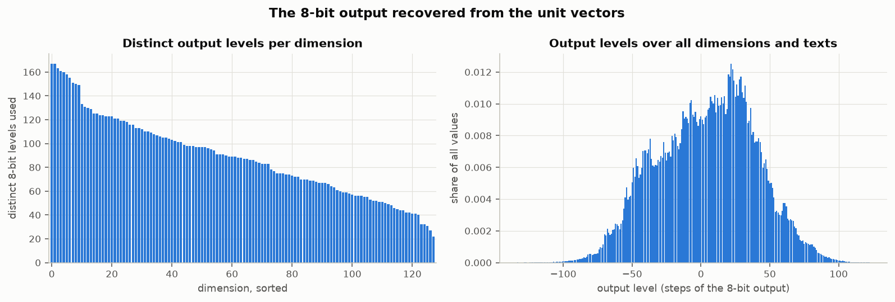

## Verdict

The vectors are not garbage and not noise: the same input gives the same bits,
small edits stay close, attacks move away from benign requests, endpoints and
labels form groups far outside what the two controls give. They are also not a
general description of a log line. The encoder was trained to tell good from
bad, and the vectors are that score on a curve with one to five effective
dimensions out of 128.

| Consumer | Verdict | Why |
|---|---|---|
| Linear head (task 2.10) | Suitable with limits | ROC AUC 0.939 on the three held-out endpoints, 0.936 from the first principal component alone. The head is one direction that the encoder already holds; it adds nothing a threshold on that direction would not. Shuffled-label controls are unreliable on these vectors and must be repeated, not run once. |
| Neighbour scorer (task 2.8) | Suitable only where the store holds texts of the same endpoint; not shown suitable otherwise | Within a group the neighbours agree (0.92 all, 0.96 among held-out texts). Across endpoints every held-out good text gets a bad majority; ROC AUC 0.79 on distinct inputs, 0.55 with repeated inputs. Repeated inputs must be removed or counted once before neighbours are taken. |
| Outlier ranking (task 2.11) | Not checked; doubtful | No outlier scorer was run. What was measured speaks against distance as novelty: every probe, random bytes included, has a CSIC vector at cosine 0.98 or more, random texts land among attacks, and a request the application does not have lands among benign ones. |

Limits that hold for all three:

- The method and the path are not read. Attacks in the path, and every log line
  without `?` or line feed, get one shared vector (1,634 CSIC texts, 1,614 of
  them bad). For plain log lines outside the CSIC layout this encoder gives one
  point: that is the collapse of the spike model, for a class of inputs.
- Nothing after byte 256 of the payload is read (4,821 CSIC texts).
- Inputs that differ in digits can share a vector (1,408 inputs on 381 vectors).
- What separates is "like normal CSIC traffic or not". Attack classes are not
  told apart, upper case counts as an attack, and one of the eight attack
  values tried (`|ping`) stays on the benign side in two of three requests.

Whether a one-dimensional score in 128 numbers is a basis for a "proper ML
implementation" of the decision part is the owner's call, not this document's.
The measurements say: the planned scorers would mostly re-read one learned
direction, and where they go beyond it (neighbours across endpoints) they are
weak.

## What was not checked

- One model: the published model of task 2.1 (split of the 1.7 note, seed 0,
  epoch 2). The science gate's neighbour figure for this model (0.592) is the
  lowest of its three seeds (0.592, 0.709, 0.780). The 15 fold models and other
  seeds were not looked at here.
- One dataset. No second dataset, no real traffic, no log format other than
  CSIC's. The held-out endpoints are from the same application.
- The 72 probes were written by hand and are few; the attack values are textbook
  ones. Counts over them are examples, not rates.
- No outlier scorer, no calibration, no conformal step was run.
- The float model and the CPU were not run: nothing here says what quantisation
  or the NPU changed. The science gate recorded a float-to-8-bit cosine of
  0.9999 on average for this model.
- Whether another training objective would give more dimensions was not tried.
  The science gate's record of its `supcon` run reads "every held-out log lands
  next to bad logs", which is the pattern found here.
- UMAP pictures depend on its settings (cosine, 15 neighbours, minimum distance
  0.1, one seed); no figure in this document is taken from them.
- The label of an input that carries both labels (28 inputs) is the label of its
  first text.

## How to rerun

Step by step in [`tools/embedding-qualification/README.md`](../tools/embedding-qualification/README.md).
In short: the Rust test `npu_embedding_export` (release, on request, with
`L2D_RUNTIME_DIR`, `L2D_SCIENCE_DIR`, `L2D_CSIC_CSV`, `L2D_NPU_WORK_DIR`,
`L2D_EXPORT_DIR`) writes the vector files outside the repository; then
`run_all.ps1` in `tools/embedding-qualification` runs five scripts with `uv` and
writes the pictures here and the logs beside the vectors.

| Log (`D:\BuildArtifacts\log2decision\task-2.15\logs\`) | From | Holds |
|---|---|---|
| `export-1.log` | `npu_embedding_export.rs` | Session, placement, checksum, flags, the two bit checks |
| `q0.log` | `q0_inputs.py` | Texts per input, empty inputs, the split's counts |
| `q1.log` | `q1_collapse.py` | Distinct vectors, pairwise cosine, spread |
| `q2.log` | `q2_similarity.py` | All probes and pairs, rank correlations, neighbours as text |
| `q3.log` | `q3_structure.py` | Split check, PCA, k-means, silhouette, neighbours, held-out figures |
| `q4.log` | `q4_dimensions.py` | PCA spectrum, dead dimensions, output levels |
