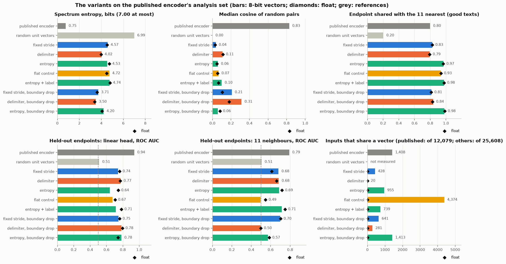
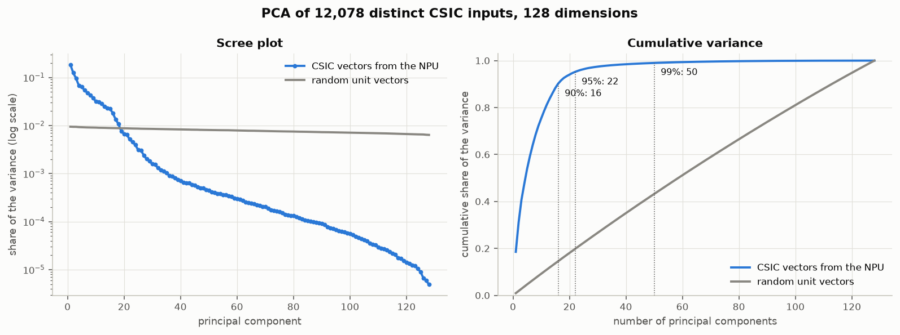
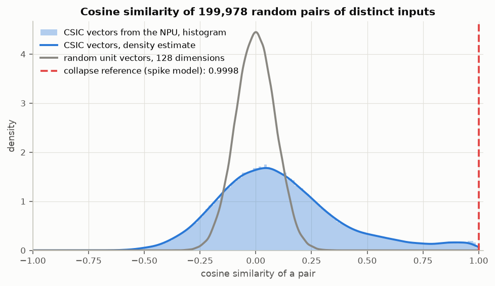
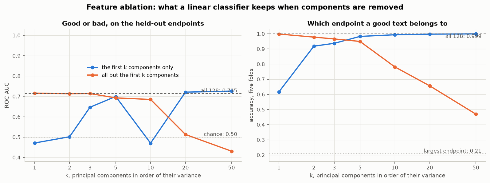
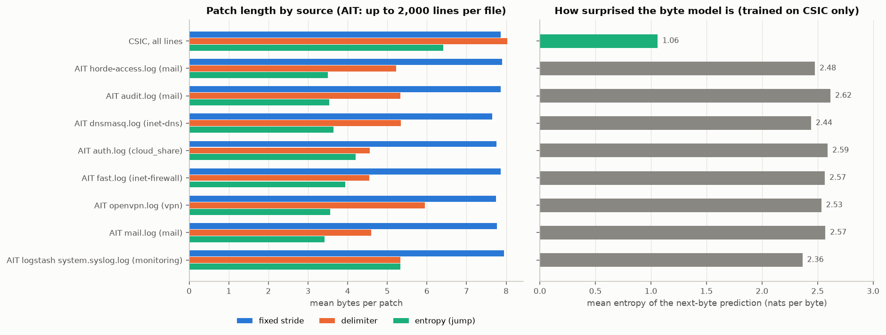
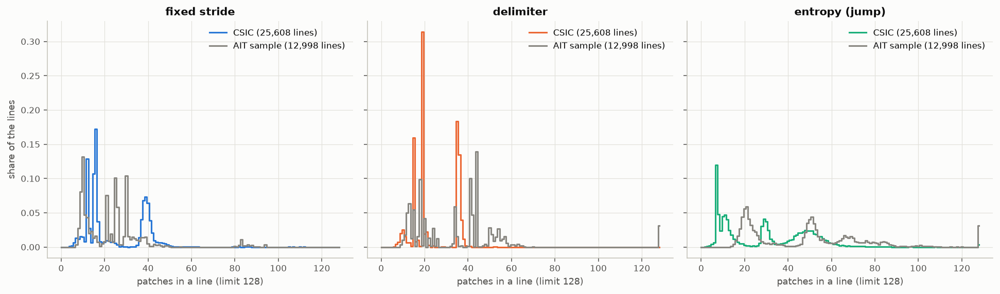
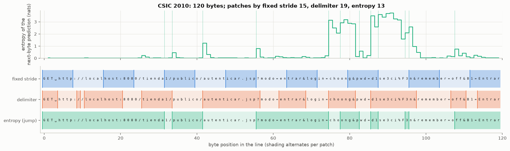
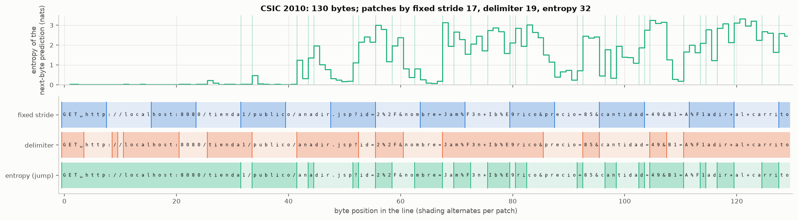
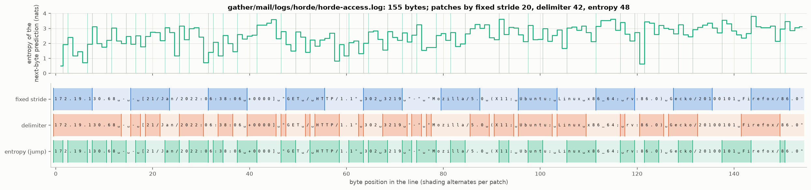
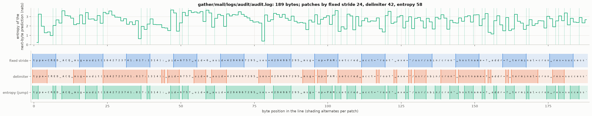

# Hierarchical encoder gate: do patches and a content objective give vectors that keep the line?

2026-11-14. Task 2.16 of the spec `npu-log-decision`, the gate the
[research log](2026-11-14-research-log-encoder-direction.md) asked for after the
[embedding qualification](2026-11-14-embedding-qualification.md) found the
published encoder's vectors on one line. A development spike: training and
analysis in Python through `uv` (`tools/science/hg.py`, `hg_run.py`), the
qualification with the scripts of task 2.15 (`tools/embedding-qualification/`),
the hardware check in Rust through `ort`
(`crates/l2d-encoder/tests/npu_hierarchical_gate.rs`), on the reference host
(NPU driver 32.0.20102.4480, AMD Ryzen AI 1.9.0). Every figure below is in a
named file under `D:\BuildArtifacts\log2decision\task-2.16\`; the section "Where
the figures are" lists them. Each figure rests on one seed unless the text says
otherwise.

## The answer

**No variant passes the gate as a whole. The geometry the owner asked for is
there, and the layout runs on the NPU. But entropy patching does not beat the two
controls, and vectors trained to keep the content of a line rank attacks far
worse than the published encoder and the baseline scorer.** The last point is one
of the research log's "we are wrong if" conditions, so this goes to the owner
before any scorer is built on such vectors.

1. **Do the vectors use many dimensions, and keep similar lines near and
   unrelated ones apart? Yes.** Every variant trained without the label needs 12
   to 32 principal components for 95 % of the variance (published encoder: 2;
   17 to 32 under the first objective), has a spectrum entropy of 3.5 to 4.7
   bits of 7.00 (published: 0.75), and a median cosine between two random CSIC
   texts of 0.02 to 0.31 (published: 0.83). One character changed keeps a cosine
   of 0.97 to 0.999; two different benign requests are at -0.08 to 0.25
   (published: 0.87).
2. **Does entropy patching beat fixed stride and delimiter patches? No.** On the
   quantity that failed in task 2.15, the neighbours on held-out endpoints, the
   three patchers are level (0.68, 0.68, 0.69 in 8 bits with the first seed;
   0.50, 0.52, 0.62 with a second) and all below the published encoder (0.79). Entropy patches are worse where it matters for
   "similar near": one value changed gives a cosine of 0.68 against 0.92 (fixed
   stride) and 0.96 (delimiters), because a changed value moves the cuts and the
   vector follows the cuts. For the same reason its 8-bit vectors are not its
   float vectors (median cosine 0.24): the 8-bit entropy model cuts 99 % of the
   lines at least one boundary differently. A second objective that also drops
   patch boundaries at random repairs this (0.96, one value changed 0.88), at the
   cost of more folding. Entropy patches group endpoints best (0.97 against 0.83
   and 0.79) and cost two to three times the time per log.
3. **Does the hierarchy add anything over the flat control with the same
   objective? In folding, yes; elsewhere little.** In 8 bits the flat control
   folds 4,374 of 25,608 inputs into shared vectors; the hierarchical variants
   fold 20 (delimiter), 428 (fixed stride) and 955 (entropy). One value changed
   gives 0.49 against 0.68 to 0.96. Dimensions, spread and the linear head are
   the same as the hierarchical variants'. So the
   many dimensions come from the objective, not from the patches.
4. **Does the layout run on the NPU at the required speed with every row right?
   Yes.** Both graphs compile and
   run on the NPU only, by the placement report and the profile of a first run.
   1,118 comparisons of a text in other rows, beside other texts and alone
   differ in no bit. End to end, with the entropy model as part of the byte
   graph: 1,191 to 1,497 logs per second in the runs made while this host also
   trained models and 2,202 to 2,485 afterwards; fixed stride 2,814 to 7,241.
   The requirement is 1,000. The
   byte graph on the NPU is bit-identical to the Python 8-bit reference; the line
   graph is not (median cosine 0.97 between the NPU's vector and the reference).
5. **How much folding is left?** In float none: 25,608 distinct lines give
   25,608 distinct vectors in every variant. In 8 bits some, see point 3; the
   published encoder folded 1,408 of 12,079 inputs and gave one vector to 1,634
   texts it could not read at all. No CSIC line is longer than the layout reads.
6. **What does triage quality cost? Most of it.** On the three held-out
   endpoints the linear head on the 8-bit vectors reaches ROC AUC 0.57 to 0.80
   (published encoder 0.939; baseline scorer on all texts of those endpoints
   0.989 with method and path stripped, 0.996 with the whole text). With the science gate's head a second seed of the fixed-stride variant gave
   0.46 where the first gave 0.73, and heads fitted on
   shuffled labels reach up to 0.78, so these figures carry little signal at
   all. The label as a secondary term (weight 0.5) does not repair it: 0.71.

**Recommendation.** Do not replace the published encoder with any variant of
this spike, and do not build the neighbour scorer, the linear head or the
outlier ranking on them. What the spike settles for a next step: the objective
is what spreads the vectors; the layout is feasible on the NPU; delimiter
patches are the patcher to carry forward if patches are kept (level with entropy
on the gate's measurements, the least folding, stable under 8 bits, no entropy
model to run); and a vector that keeps the content does not by itself carry the
good/bad question in a form a linear head or a distance can read. The details,
and what the package would have to change, are in "Recommendation" below.

## What was built

**The layout.** Two fixed-shape 8-bit graphs with plain arithmetic between them.
In both, the texts are the rows of one image, so every kernel reaches along one
axis only (the layout task 2.12 found right on the NPU).

| Stage | What it does | Shape |
|---|---|---|
| Byte table | 256 rows of 64 values, row 0 zero (padding); looked up on the CPU | line of up to 1,024 bytes |
| Byte graph | Four causal convolutions, kernel `[1, 9]` with the four taps right of the centre zero, 96 channels; a 1 x 1 convolution to 256 next-byte logits. Output `h`: the features after the second convolution. Output `y`: relu(logit + 12) | `[1, 64, 16, 1024]` to `[1, 96, 16, 1024]` and `[1, 256, 16, 1024]` |
| Between (CPU, not a model run) | Entropy of each next-byte prediction (entropy patcher only), the patch boundaries, the mean of `h` over the bytes of each patch | up to 128 patches per line |
| Line graph | Four convolutions, kernel `[1, 5]`, 192 channels, strides 1, 2, 2, 1; one average over the 32 positions left; a 1 x 1 convolution to 128 | `[1, 96, 64, 128]` to `[1, 128, 64, 1]` |
| After | L2 normalisation on the CPU | 128 values, length 1 |

329,344 parameters in the byte graph, 670,592 in the line graph, 16,384 in the
table: 1.02 million, against 0.99 million for the published encoder. The 8-bit
files are 338 kB (byte graph with logits; 142 kB without) and 680 kB.

**The byte model** is trained first, once, on the training part of the fitting
side (15,713 texts; no held-out endpoint, no validation path, no label):
next-byte prediction, 8 epochs, 369 s. Cross-entropy at the end: 1.20 bits per
byte on the training texts, 1.82 on the validation path, 2.42 on the three
held-out endpoints (`logs\bytelm-s0.log`). It is the entropy model and the
feature extractor of every variant, the flat control included. Its features are
taken after the second of four layers; that choice was made in advance and not
varied.

**The three patchers**, set to the same budget: the mean patch count of the
fixed-stride patcher on the training lines, 22.17 (`features\s0\patching.json`).

- *Fixed stride*: a patch every 8 bytes.
- *Delimiter*: a patch ends after one of ``space tab newline / ? & = : ; , | " ' ( ) [ ] { } < >``.
  With every delimiter cutting, the mean is 22.19, so no minimum length was
  needed.
- *Entropy*, after the Byte Latent Transformer's patcher
  (`bytelatent/data/patcher.py`, read for the method; no weights were
  downloaded): the entropy of the model's prediction of byte t+1, natural log. A
  patch starts at byte t+1 where that entropy exceeds the previous one by more
  than a threshold (BLT's monotonic rule; "where the entropy jumps"). The
  threshold that meets the budget is 0.436 nats. BLT's global rule (entropy above
  2.77 nats) was calibrated and counted but not trained.
- For all three: no patch is longer than 32 bytes (BLT's `max_patch_length`), and
  a line has at most 128 patches; the bytes of any further patch are pooled into
  the last one, so no byte is dropped.

**The line model and its objective.** The label is not used. Contrastive
(SimCLR's NT-Xent, temperature 0.1) on the unit vector itself: two views of each
line, each with a random 30 % of its patches set to zero; the two views of a line
are the positives, the other 510 views of the batch the negatives. Plus
mean((length - 1)^2) on the raw vector, as the published model has it for the
8-bit output. AdamW, learning rate 0.001 one-cycle, weight decay 0.01, batch 256,
12 epochs, the last epoch kept (no selection on anything), seed 0. Contrastive
was chosen over masked-patch prediction because its loss acts on the vector the
store keeps and the scorers compare by cosine; a masked-patch loss acts on patch
outputs and leaves the pooled vector to chance unless a decoder is added. The
masked-patch objective is implemented (`--objective masked`) and was not run.

**The variants.**

| Variant | Patcher | Objective |
|---|---|---|
| fixed stride | fixed stride | contrastive, patches masked |
| delimiter | delimiter | the same |
| entropy | entropy, jump rule | the same |
| flat control | none: the line graph's convolutions (strides 2, 2, 2, 1) run over the 1,024 byte features, then one average | the same, with 8-byte blocks masked |
| entropy + label | entropy | the same, plus 0.5 x binary cross-entropy on a classifier that reads 16 x the unit vector |
| entropy, boundary drop | entropy | the same, and each view also loses 15 % of its patch boundaries at random (two patches become one) |

The last one was added after the first results showed how much the vector
depends on the cuts (below). Training took 14 to 27 minutes per hierarchical
variant and 51 minutes for the flat control, with other work on the machine.

**Every variant is measured twice**: in float (the PyTorch models) and in 8 bits
(both graphs quantized as the published model was, static QDQ, min/max over 256
and 512 training texts, run through ONNX Runtime on the CPU in Python; this is
"the Python 8-bit reference"). In 8 bits the entropy patcher cuts by the 8-bit
graph's entropies.

**The qualification** is the scripts of task 2.15 unchanged in what they compute.
`eq.py` got three options (`--input whole`, `--input-bytes 1024`, `--source`); a
run without them is the published model's and gives the figures of task 2.15
(checked: `check-published\q1.log` differs from the log of task 2.15 by one
added line). The encoders here read the whole line, so all 25,608 distinct CSIC
texts are distinct inputs; the analysis set is kept at the published encoder's
12,078 texts (the first text of every distinct non-empty payload), so that the
rows of the tables compare like with like. The folding counts are over all
25,608 texts.

## The comparison

Published encoder and random unit vectors first. "8-bit" is the Python 8-bit
reference; "8-bit, NPU" are vectors the NPU gave.

**Table 1: dimensions, and near and apart**

| Vectors | Precision | Components for 95 % of the variance (features scaled) | Spectrum entropy, bits (scaled) | Random pairs, median cosine | One character changed | One value changed | Different benign requests | Text distance against vector distance, Spearman | Float against 8-bit vector, median cosine |
|---|---|---|---|---|---|---|---|---|---|
| published encoder | 8-bit, NPU | 2 (3) | 0.75 (1.22) | 0.83 | 0.9998 | 0.996 | 0.87 | 0.19 | – |
| random unit vectors | float | 121 (121) | – (6.99) | 0.00 | – | – | – | – | – |
| fixed stride | float | 25 (26) | 4.53 (4.61) | 0.03 | 0.9994 | 0.931 | 0.21 | 0.16 | – |
| fixed stride | 8-bit | 26 (26) | 4.57 (4.64) | 0.04 | 0.9969 | 0.919 | 0.25 | 0.16 | 0.994 |
| fixed stride, seed 1 | 8-bit | 29 (29) | 4.66 (4.75) | 0.02 | 0.9940 | 0.930 | -0.06 | 0.21 | 0.988 |
| delimiter | float | 16 (17) | 3.98 (4.07) | 0.11 | 0.9940 | 0.972 | 0.05 | 0.25 | – |
| delimiter | 8-bit | 17 (17) | 4.02 (4.11) | 0.11 | 0.9887 | 0.961 | 0.04 | 0.25 | 0.996 |
| delimiter, seed 1 | 8-bit | 16 (16) | 3.98 (4.07) | 0.10 | 0.9739 | 0.987 | -0.08 | 0.22 | 0.995 |
| entropy | float | 31 (32) | 4.72 (4.84) | 0.05 | 0.9571 | 0.681 | -0.17 | 0.07 | – |
| entropy | 8-bit | 31 (32) | 4.53 (4.69) | 0.06 | 0.9669 | 0.675 | -0.02 | 0.24 | 0.238 |
| entropy, seed 1 | 8-bit | 32 (33) | 4.74 (4.85) | 0.08 | 0.9818 | 0.580 | 0.00 | 0.17 | 0.278 |
| flat control | float | 23 (23) | 4.49 (4.55) | 0.06 | 0.9996 | 0.662 | 0.01 | 0.30 | – |
| flat control | 8-bit | 30 (31) | 4.72 (4.79) | 0.07 | 0.9958 | 0.488 | 0.02 | 0.25 | 0.950 |
| entropy + label | float | 32 (33) | 4.78 (4.88) | 0.07 | 0.9635 | 0.679 | -0.09 | 0.08 | – |
| entropy + label | 8-bit | 33 (34) | 4.74 (4.85) | 0.10 | 0.9808 | 0.525 | 0.03 | 0.17 | 0.278 |
| fixed stride, boundary drop | float | 13 (14) | 3.62 (3.72) | 0.11 | 0.9999 | 0.846 | -0.20 | 0.28 | – |
| fixed stride, boundary drop | 8-bit | 14 (14) | 3.71 (3.80) | 0.21 | 0.9987 | 0.861 | -0.03 | 0.32 | 0.966 |
| delimiter, boundary drop | float | 11 (11) | 3.38 (3.46) | 0.18 | 0.9914 | 0.981 | 0.06 | 0.35 | – |
| delimiter, boundary drop | 8-bit | 12 (13) | 3.50 (3.60) | 0.31 | 0.9803 | 0.974 | 0.08 | 0.34 | 0.907 |
| entropy, boundary drop | float | 19 (20) | 4.06 (4.17) | 0.08 | 0.9959 | 0.862 | -0.11 | 0.33 | – |
| entropy, boundary drop | 8-bit | 21 (22) | 4.20 (4.31) | 0.06 | 0.9741 | 0.880 | -0.06 | 0.34 | 0.960 |
| entropy, boundary drop | 8-bit, NPU | 22 (23) | 4.24 (4.34) | 0.07 | 0.9460 | 0.846 | -0.09 | 0.34 | – |

**Table 2: structure, the held-out endpoints, feature ablation**

| Vectors | Precision | Label shared with the 11 nearest | Endpoint shared with the 11 nearest (good texts) | Held-out linear head, ROC AUC | Held-out 11 neighbours, ROC AUC | Ablation, all 128 components: label ROC AUC / endpoint accuracy | First component only | Without the first 5 | Without the first 20 |
|---|---|---|---|---|---|---|---|---|---|
| published encoder | 8-bit, NPU | 0.922 | 0.798 | 0.939 | 0.791 | 0.939 / 0.802 | 0.936 / 0.756 | 0.517 / 0.798 | 0.442 / 0.634 |
| random unit vectors | float | 0.521 | 0.202 | 0.511 | 0.507 | 0.511 / 0.203 | – / – | – / – | – / – |
| fixed stride | float | 0.757 | 0.825 | 0.760 | 0.611 | 0.699 / 1.000 | 0.379 / 0.522 | 0.659 / 1.000 | 0.507 / 0.985 |
| fixed stride | 8-bit | 0.754 | 0.826 | 0.740 | 0.680 | 0.743 / 0.999 | 0.351 / 0.497 | 0.626 / 0.996 | 0.402 / 0.955 |
| fixed stride, seed 1 | 8-bit | 0.746 | 0.860 | 0.566 | 0.495 | 0.582 / 1.000 | 0.383 / 0.412 | 0.416 / 0.995 | 0.426 / 0.983 |
| delimiter | float | 0.702 | 0.793 | 0.769 | 0.660 | 0.644 / 0.959 | 0.711 / 0.347 | 0.515 / 0.954 | 0.245 / 0.784 |
| delimiter | 8-bit | 0.703 | 0.793 | 0.772 | 0.682 | 0.629 / 0.916 | 0.713 / 0.346 | 0.610 / 0.894 | 0.223 / 0.616 |
| delimiter, seed 1 | 8-bit | 0.697 | 0.788 | 0.795 | 0.518 | 0.745 / 0.871 | 0.195 / 0.400 | 0.673 / 0.863 | 0.303 / 0.639 |
| entropy | float | 0.727 | 0.966 | 0.743 | 0.717 | 0.670 / 1.000 | 0.302 / 0.645 | 0.591 / 0.997 | 0.621 / 0.966 |
| entropy | 8-bit | 0.705 | 0.967 | 0.641 | 0.686 | 0.618 / 1.000 | 0.477 / 0.703 | 0.598 / 0.962 | 0.489 / 0.782 |
| entropy, seed 1 | 8-bit | 0.699 | 0.955 | 0.631 | 0.621 | 0.659 / 0.999 | 0.408 / 0.467 | 0.589 / 0.949 | 0.559 / 0.850 |
| flat control | float | 0.734 | 0.936 | 0.705 | 0.547 | 0.598 / 1.000 | 0.612 / 0.636 | 0.625 / 0.991 | 0.409 / 0.916 |
| flat control | 8-bit | 0.728 | 0.933 | 0.672 | 0.495 | 0.620 / 1.000 | 0.605 / 0.616 | 0.608 / 0.924 | 0.429 / 0.800 |
| entropy + label | float | 0.736 | 0.976 | 0.782 | 0.748 | 0.828 / 1.000 | 0.251 / 0.661 | 0.791 / 0.997 | 0.676 / 0.961 |
| entropy + label | 8-bit | 0.713 | 0.976 | 0.714 | 0.714 | 0.722 / 1.000 | 0.289 / 0.533 | 0.615 / 0.966 | 0.397 / 0.830 |
| fixed stride, boundary drop | float | 0.767 | 0.811 | 0.760 | 0.702 | 0.724 / 1.000 | 0.330 / 0.401 | 0.624 / 0.998 | 0.451 / 0.960 |
| fixed stride, boundary drop | 8-bit | 0.763 | 0.813 | 0.746 | 0.698 | 0.760 / 0.992 | 0.332 / 0.459 | 0.748 / 0.976 | 0.584 / 0.747 |
| delimiter, boundary drop | float | 0.709 | 0.828 | 0.795 | 0.499 | 0.793 / 1.000 | 0.711 / 0.454 | 0.517 / 0.996 | 0.262 / 0.968 |
| delimiter, boundary drop | 8-bit | 0.705 | 0.836 | 0.783 | 0.497 | 0.780 / 0.981 | 0.807 / 0.448 | 0.730 / 0.931 | 0.293 / 0.639 |
| entropy, boundary drop | float | 0.736 | 0.985 | 0.741 | 0.585 | 0.744 / 1.000 | 0.407 / 0.709 | 0.713 / 0.991 | 0.469 / 0.886 |
| entropy, boundary drop | 8-bit | 0.718 | 0.978 | 0.781 | 0.572 | 0.803 / 1.000 | 0.408 / 0.673 | 0.799 / 0.945 | 0.586 / 0.645 |
| entropy, boundary drop | 8-bit, NPU | 0.722 | 0.977 | 0.737 | 0.564 | 0.715 / 0.999 | 0.471 / 0.617 | 0.693 / 0.950 | 0.513 / 0.656 |

**Table 3: folding, and the triage quality of the science gate**

| Vectors | Precision | Distinct vectors of the 12,078 texts of the analysis set | Distinct vectors of all distinct inputs | Vectors shared by different inputs (inputs that share) | Split of the 1.7 note, all texts: head / neighbours | Five folds by path, pooled: head / neighbours |
|---|---|---|---|---|---|---|
| published encoder | 8-bit, NPU | 11,051 | 11,052 of 12,079 | 381 (1,408) | 0.940 / 0.551 | – / – |
| random unit vectors | float | – | – of – | – (–) | 0.500 / 0.507 | 0.494 / 0.506 |
| fixed stride | float | 12,078 | 25,608 of 25,608 | 0 (0) | 0.692 / 0.569 | 0.613 / 0.587 |
| fixed stride | 8-bit | 11,947 | 25,362 of 25,608 | 182 (428) | 0.732 / 0.662 | 0.617 / 0.598 |
| fixed stride, seed 1 | 8-bit | 11,898 | 25,249 of 25,608 | 263 (622) | 0.461 / 0.492 | 0.547 / 0.602 |
| delimiter | float | 12,078 | 25,608 of 25,608 | 0 (0) | 0.641 / 0.664 | 0.583 / 0.643 |
| delimiter | 8-bit | 12,075 | 25,598 of 25,608 | 10 (20) | 0.637 / 0.575 | 0.580 / 0.632 |
| delimiter, seed 1 | 8-bit | 12,072 | 25,587 of 25,608 | 21 (42) | 0.614 / 0.518 | 0.603 / 0.639 |
| entropy | float | 12,078 | 25,608 of 25,608 | 0 (0) | 0.660 / 0.652 | 0.584 / 0.622 |
| entropy | 8-bit | 11,760 | 25,042 of 25,608 | 389 (955) | 0.584 / 0.637 | 0.567 / 0.554 |
| entropy, seed 1 | 8-bit | 11,696 | 24,879 of 25,608 | 491 (1,220) | 0.517 / 0.604 | 0.560 / 0.547 |
| flat control | float | 12,078 | 25,608 of 25,608 | 0 (0) | 0.743 / 0.595 | 0.667 / 0.632 |
| flat control | 8-bit | 10,505 | 22,452 of 25,608 | 1,218 (4,374) | 0.693 / 0.598 | 0.665 / 0.638 |
| entropy + label | float | 12,078 | 25,608 of 25,608 | 0 (0) | 0.728 / 0.734 | 0.692 / 0.688 |
| entropy + label | 8-bit | 11,861 | 25,193 of 25,608 | 324 (739) | 0.629 / 0.614 | 0.615 / 0.603 |
| fixed stride, boundary drop | float | 12,078 | 25,608 of 25,608 | 0 (0) | 0.729 / 0.683 | 0.578 / 0.653 |
| fixed stride, boundary drop | 8-bit | 11,915 | 25,254 of 25,608 | 287 (641) | 0.745 / 0.676 | 0.579 / 0.661 |
| delimiter, boundary drop | float | 12,078 | 25,608 of 25,608 | 0 (0) | 0.752 / 0.495 | 0.681 / 0.637 |
| delimiter, boundary drop | 8-bit | 12,019 | 25,462 of 25,608 | 135 (281) | 0.743 / 0.506 | 0.675 / 0.620 |
| entropy, boundary drop | float | 12,078 | 25,608 of 25,608 | 0 (0) | 0.660 / 0.599 | 0.559 / 0.638 |
| entropy, boundary drop | 8-bit | 11,658 | 24,712 of 25,608 | 517 (1,413) | 0.756 / 0.555 | 0.540 / 0.615 |
| entropy, boundary drop | 8-bit, NPU | 11,717 | 24,827 of 25,608 | 488 (1,269) | – / – | – / – |

How to read the tables, column by column where it is not plain:

- *Components for 95 %* and *spectrum entropy*: log2ml's count and the Shannon
  entropy of the variance spectrum (`q5.log`), without and with every feature
  scaled to unit variance. Random unit vectors: 121 components, 6.99 bits.
- *One character changed*, *one value changed*, *different benign requests*:
  medians over the probe pairs of task 2.15 (`q2.log`; 3, 3 and 10 pairs).
- *Held-out linear head* and *held-out 11 neighbours*: fitted on the fitting side
  of the analysis set, scored on the 2,399 texts of the three held-out endpoints
  (`q3.log`). The neighbour figure is the one that failed in task 2.15.
- *Ablation*: a logistic regression on principal components scaled to unit
  variance; the label on the held-out endpoints (trained for by the published
  encoder, by none of the label-free variants), and which of five endpoints a
  good text belongs to (`q5.log`). The encoders here read the path, so the
  endpoint is no longer a hidden question for them: 1.000 is expected. What the
  ablation still shows is where the content sits: without the first five
  components the published encoder loses the label (0.52) and these variants
  keep the endpoint (0.86 to 1.00), although those five components hold 42 to
  69 % of their variance; the content is spread over many components that each
  hold a real share of the variance (`q4.log`: the first ten hold 62 to 93 %).
- *Split of the 1.7 note* and *five folds by path*: the science gate's own
  scorers (`l2dsci.linear_head` with its penalty search, `knn_ratio` with
  k = 11) on all 25,608 texts. For the five folds each encoder was fitted once,
  without the three held-out endpoints; the scorers hold no label of the
  held-out fold, but the encoder has seen unlabelled texts of four of the five
  large endpoints (and the label variant their labels). The published encoder
  has no row there: its fold figures are those of the science gate, 0.959 for
  the head and 0.893 for the neighbours, from fifteen models fitted per fold.

### 1. Dimensions, near and apart

The published encoder's picture, for scale: one component holds 88 % of the
variance. The picture of the variant that went to the NPU (entropy with boundary
drop), from the vectors the NPU gave:

Near and apart hold together, which the published encoder did not manage: there
an attack sat at 0.38 from its benign request while two unrelated benign
requests sat at 0.87. Here unrelated requests are near 0 and an edit stays near
1. What is lost is the published encoder's one useful distance: benign and attack
are no longer on two sides of anything (random good-bad pairs have the same
cosine distribution as good-good pairs, `q1.log`).

### 2. Entropy patches against the two controls

Under the same objective and budget, in 8 bits:

| Measure | Fixed stride | Delimiter | Entropy | Better is |
|---|---|---|---|---|
| Components for 95 % | 26 | 17 | 31 | more |
| Random pairs, median cosine | 0.04 | 0.11 | 0.06 | lower |
| One character changed | 0.997 | 0.989 | 0.967 | higher |
| One value changed | 0.919 | 0.961 | 0.675 | higher |
| Endpoint shared with the 11 nearest | 0.826 | 0.793 | 0.967 | higher |
| Held-out 11 neighbours, ROC AUC | 0.680 | 0.682 | 0.686 | higher |
| Held-out linear head, ROC AUC | 0.740 | 0.772 | 0.641 | higher |
| Inputs that share a vector, of 25,608 | 428 | 20 | 955 | fewer |
| Float against 8-bit vector, median cosine | 0.994 | 0.996 | 0.238 | higher |

Entropy wins two rows (components, endpoint grouping), is level on one and loses
the rest. The seed section below says how little the two ROC AUC rows can carry.

**Why the entropy variant's 8-bit vectors are other vectors.** The 8-bit byte
graph's entropies differ from the float model's by 0.018 nats on average (99th
percentile 0.12; correlation 0.9997). That is enough to move a cut: of 767,905
patch starts on CSIC the two agree on 719,137, and only 180 of 25,608 lines keep
all their boundaries (`features\s0\patching.json`, `scratch\entdiff.py`). And
the line model follows the cuts: with the float features and the 8-bit cuts the
vectors have a median cosine of 0.23 to the float vectors; with the 8-bit
features and the float cuts 0.9999; with one random boundary removed per line
0.61 (`scratch\why.py`, on 1,500 lines). So the vector is a function of the
segmentation as much as of the bytes. The same effect makes "one value changed"
drop to 0.68: another value, other surprises, other cuts.

A first run of the spike had the raw logits as the graph output. Their min/max
range was about 160 wide, the 8-bit step 0.63 nats, and 137 lines kept their
boundaries (`first-run-raw-logits\`). The byte model was then retrained with a
penalty that keeps its logits near log-probabilities (0.1 x the squared
log-normaliser) and the graph gives relu(logit + 12): the step is 0.057 nats.
That did not change the picture (180 lines), because the difference comes from
the quantized layers before the logits, not from the logits' own step.

**Boundary drop.** Training the same model with views that also lose 15 % of
their boundaries makes the vector hold still: float against 8-bit 0.96, one
value changed 0.88, one character 0.974. It costs dimensions (21 components
against 31) and folding (1,413 inputs against 955), and the neighbours on
held-out endpoints fall to 0.57.

The two controls were trained with the same boundary drop, so that the three
patchers can also be compared under this second objective (8 bits):

| Measure | Fixed stride | Delimiter | Entropy |
|---|---|---|---|
| Components for 95 % | 14 | 12 | 21 |
| Random pairs, median cosine | 0.21 | 0.31 | 0.06 |
| One character changed | 0.999 | 0.980 | 0.974 |
| One value changed | 0.861 | 0.974 | 0.880 |
| Endpoint shared with the 11 nearest | 0.813 | 0.836 | 0.978 |
| Held-out 11 neighbours, ROC AUC | 0.698 | 0.497 | 0.572 |
| Held-out linear head, ROC AUC | 0.746 | 0.783 | 0.781 |
| Inputs that share a vector, of 25,608 | 641 | 281 | 1,413 |
| Float against 8-bit vector, median cosine | 0.966 | 0.907 | 0.960 |

The boundary drop costs every patcher dimensions and brings random pairs closer
for the two controls; with it the entropy patcher keeps the most dimensions and
the best spread, is no longer behind on "one value changed", and still folds
most and does not lead on the held-out endpoints. For the controls, whose cuts
do not depend on a model, the boundary drop was not needed and made the 8-bit
vectors less like the float ones (0.97 and 0.91 against 0.99).

### 3. The hierarchy against the flat control

The flat control has the same byte model, the same objective and the same
convolutions; it lacks only the patches. In 8 bits: 30 components, median cosine
of random pairs 0.07, one character changed 0.996, endpoint shared with the 11
nearest 0.93, held-out head 0.67: inside the range of the hierarchical variants.
It differs in two rows that hold: one value changed 0.49 (hierarchical 0.68 to 0.96),
held-out neighbours 0.49 (0.68 to 0.69 in the same seed; 0.50 to 0.62 in a second
seed of the three patchers, so this row shows nothing), and 4,374 inputs that
share a vector (20 to 955). It also took about three times as long to train, because its
convolutions run over 1,024 positions instead of 128.

### 4. Seeds

The three patchers were trained a second time with another seed for the line
model (the byte model is the same), and the 8-bit vectors qualified. Seed 0 /
seed 1:

| Measure, 8 bits | Fixed stride | Delimiter | Entropy |
|---|---|---|---|
| Components for 95 % | 26 / 29 | 17 / 16 | 31 / 32 |
| Random pairs, median cosine | 0.04 / 0.02 | 0.11 / 0.10 | 0.06 / 0.08 |
| One value changed | 0.919 / 0.930 | 0.961 / 0.987 | 0.675 / 0.580 |
| Endpoint shared with the 11 nearest | 0.826 / 0.860 | 0.793 / 0.788 | 0.967 / 0.955 |
| Inputs that share a vector, of 25,608 | 428 / 622 | 20 / 42 | 955 / 1,220 |
| Float against 8-bit vector, median cosine | 0.994 / 0.988 | 0.996 / 0.995 | 0.238 / 0.278 |
| Held-out 11 neighbours, ROC AUC | 0.680 / 0.495 | 0.682 / 0.518 | 0.686 / 0.621 |
| Held-out linear head, ROC AUC | 0.740 / 0.566 | 0.772 / 0.795 | 0.641 / 0.631 |
| Science gate's head, split of the 1.7 note | 0.732 / 0.461 | 0.637 / 0.614 | 0.584 / 0.517 |

- **The geometry is the same in both seeds**: dimensions, spread, the endpoint
  grouping, the order of the patchers in folding and in "one value changed".
  What the document says about them rests on two seeds for these three variants.
- **The ROC AUC figures on the held-out endpoints are not stable**: the same
  variant moves by up to 0.19 (neighbours) and 0.27 (the science gate's head)
  between two seeds, more than any difference between two patchers. With two
  seeds the neighbours average 0.59 (fixed stride), 0.60 (delimiter) and 0.65
  (entropy); that is no measured lead.
- All other variants (flat control, label, boundary drop) have one seed.

## Patching on a source the entropy model has not seen

The AIT sample: the first lines (up to 2,000) of eight `*.log` entries of
`russellmitchell.zip`, read from the archive without unpacking it, 12,998 lines
(`ait\sample.jsonl`; two entries have fewer than 2,000 lines).

| | CSIC, 25,608 lines | AIT sample, 12,998 lines |
|---|---|---|
| Line length, bytes: median / 95th percentile / longest | 128 / 340 / 891 | 166 / 332 / 1,082 |
| Lines longer than 1,024 bytes (cut and flagged) | 0 | 1 |
| Entropy of the next-byte prediction, mean nats per byte | 1.06 (training texts 0.91, held-out endpoints 1.16) | 2.52 (2.36 to 2.62 per file) |
| Fixed stride: patches per line / bytes per patch | 24.5 / 7.9 | 22.9 / 7.8 |
| Delimiter: patches per line / bytes per patch | 23.9 / 8.0 | 35.3 / 5.1 |
| Entropy, jump rule: patches per line / bytes per patch | 30.0 / 6.4 | 47.8 / 3.8 |
| Entropy, global rule: patches per line / bytes per patch | 26.7 / 7.2 | 71.5 / 2.5 |
| Lines at the 128-patch limit: fixed / delimiter / entropy jump / entropy global | 0 / 0 / 96 / 0 | 1 / 406 / 406 / 734 |

- **The objection of the research log holds.** On a source it was not trained on
  the byte model is surprised nearly everywhere (2.52 nats per byte against
  1.06), and entropy patches shrink from 6.4 to 3.8 bytes. With the global rule
  they shrink to 2.5 bytes and 734 lines hit the patch limit: the jump rule is
  the more robust of the two, because it reads differences and not levels.
- **Already inside CSIC the budget does not hold for entropy patches**: 22.9
  patches per line on the training texts, 31.3 on the held-out endpoints, where
  fixed stride and delimiters give 17.4 and 18.9 (the held-out lines are
  shorter). The entropy patcher spends more patches where the model knows less.
- **Delimiter patches also change with the source** (5.1 bytes on AIT against
  8.0), because other logs have more delimiters; that is a property of the text,
  not of a model, and it is the same in float and in 8 bits.
- **The patch limit is reached by long lines only**: CSIC has 96 lines longer
  than 512 bytes, and the 406 AIT lines are the logstash JSON lines (mean 682
  bytes). Their tail is pooled into the last patch.

Where the three patchers cut, on a CSIC line of the training part and on three
AIT lines. On CSIC the entropy stays near zero through method, host and path and
jumps at the parameter values; on AIT it is high throughout.

**The longest line the layout handles** is 1,024 bytes and 128 patches. Beyond
1,024 bytes the line is cut at the byte and flagged, as requirement 1.5 has it
today; beyond 128 patches nothing is cut, the rest of the line is one patch. On
CSIC no line is cut (the longest has 891 bytes); in the AIT sample one of 12,998.
The sample has no file with very long lines by design of what was sampled; the
archive's large `system.service` JSON files were not sampled.

## On the NPU

`crates/l2d-encoder/tests/npu_hierarchical_gate.rs`, on request, release build,
NPU only, no CPU provider. It reuses the rig of task 2.12 and the two rules of
the session of task 2.6. Measured on the variant "entropy, boundary drop"
(`logs\npu-entropy-jitter-s0-1.log`), which has the most demanding layout: the
entropy model runs as a second output of the byte graph.

**Both graphs compile and run on the NPU.**

| Graph | Nodes in the file | Report: NPU / CPU | First run, through the Vitis AI provider | Elsewhere |
|---|---|---|---|---|
| Byte graph, outputs `h` and `y` | 27 (5 Conv, 6 QuantizeLinear, 16 DequantizeLinear) | 25 / 3 | `QuantizeLinear`, `vitis_ai_ep_1`, `DequantizeLinear`, `DequantizeLinear` | nothing |
| Line graph | 30 (5 Conv, 1 AveragePool, 7 QuantizeLinear, 17 DequantizeLinear) | 28 / 2 | `QuantizeLinear`, `vitis_ai_ep_2`, `DequantizeLinear` | nothing |

- The nodes on the CPU are the quantize node at the input and the dequantize
  nodes at the outputs, as for the published model. No operator was refused, so
  no other layout had to be sought. The masked `[1, 9]` kernel is an ordinary
  convolution to the provider.
- The report lists 28 nodes for the 27 of the byte graph: the provider splits
  the dequantize node of `h`, which is a model output and feeds the third
  convolution, into two (`h` and `h/duplicated`). The session's rule "the report
  lists exactly the nodes of the model" would refuse that; the test allows one
  more node per output beyond the first.
- The session's profile rule allows one `DequantizeLinear` outside the provider;
  on this host both run through the provider, so the rule holds as it is.
- Compiled and ready in 2.7 to 7.0 s (byte graph) and 2.4 to 4.4 s (line graph)
  over the runs; with a warm cache 0.3 to 0.5 s each.

**Every row is right (requirement 4.6).** 263 CSIC texts encoded in their order,
then reversed, rotated by 5 and by 37, and in steps of 3, so that each text sits
in another row of both images beside other texts; 66 of them alone; one text in
all 64 rows: 1,118 comparisons of vector and patch count, 0 differ, tolerance
zero bits. A second and further passes over all 25,680 texts give the same bits.

**The NPU against the Python 8-bit reference**, 25,608 CSIC texts and 72 probes:

- Byte graph: bit-identical in both outputs, features and logits, on the first
  16 lines (5.8 million values, `logs\npu-entropy-jitter-s0-stages.log`). The
  patch count is the reference's for 25,678 of 25,680 lines.
- Line graph, fed the same patch image: 6 % of its output values are equal, 13 %
  one 8-bit step apart, 81 % further, 5.2 steps on average and up to 29, where a
  typical value is about 24 steps from zero. Cosine between the NPU's vector and
  the reference's on the same image: median 0.960.
- End to end: median cosine 0.966, 1st percentile 0.916, lowest 0.872; one vector
  of 25,680 is bit-identical (`logs\npu-entropy-jitter-s0-compare.log`). For the
  fixed-stride variant: median 0.986.
- So the NPU's line graph is not ONNX Runtime's CPU arithmetic for this graph.
  Which operator differs (the two strided convolutions, the average, the last
  convolution) was not established. The measure that matters is whether the
  NPU's vectors give the qualification figures of the reference; they do, to about the differences between float and 8 bits
  (`qualification\entropy-jitter-s0-npu\` against `...-int8\`; NPU first):
  components for 95 % 22 against 21, spectrum entropy 4.24 against 4.20 bits,
  random pairs 0.07 against 0.06, one character changed 0.946 against 0.974,
  one value changed 0.846 against 0.880, endpoint shared with the 11 nearest
  0.977 against 0.978, held-out neighbours 0.564 against 0.572, held-out head
  0.737 against 0.781, inputs that share a vector 1,269 against 1,413. The two
  that move most are the two the document already calls unstable: the probe
  medians over three pairs and the held-out head.

**Logs per second, from text to unit vector**, five passes over 25,680 texts
after one untimed, 16 rows per byte image and 64 per line image:

| Variant | Runs | Logs per second, passes | Where the time goes |
|---|---|---|---|
| Entropy (byte graph with logits), while the host trained models | `logs\npu-entropy-s0-trial2.log`, `logs\npu-entropy-jitter-s0-1.log` | 1,341 to 1,497; 1,191 to 1,353 | byte graph 51 to 55 %, entropy, cuts and pooling 37 to 42 %, line graph 4 to 6 %, writing the image 2 to 3 % |
| The same, after the training runs had ended | `logs\npu-entropy-jitter-s0-2.log`, `-3.log` | 2,202 to 2,333; 2,222 to 2,485 | byte graph 59 to 60 %, entropy, cuts and pooling 32 to 33 %, line graph 5 %, writing 2 % |
| Fixed stride (byte graph of two layers), while the host trained models | `logs\npu-fixed-s0-trial.log` | 2,814 to 3,059 | byte graph 66 to 67 %, pooling 14 to 15 %, line graph 11 to 12 %, writing 7 to 8 % |
| The same, after the training runs had ended | `logs\npu-fixed-s0-2.log` | 6,721 to 7,241 | byte graph 71 to 72 %, pooling 10 %, line graph 12 to 13 %, writing 5 to 6 % |

The requirement (4.2) is 1,000. As a range over all runs: 1,191 to 2,485 logs
per second with the entropy patcher and 2,814 to 7,241 with fixed stride; the
difference between the rows is other work on the host's CPU, which the
arithmetic between the graphs shares. A first version of the entropy arithmetic
(two passes, a maximum per position) gave 926 to 989 (`logs\npu-entropy-s0-trial.log`);
the figures above are with one pass and a table of 256 exponentials, which the
8-bit logits allow. The published encoder runs at 16,000 to 42,000 logs per
second: this layout is slower by a factor of about ten with the entropy
patcher, as the byte graph reads four times the bytes at full length with wider
kernels and gives 352 values per byte. Working set 313 to 356 MiB.

## Folding

The published encoder lost inputs in three ways. What became of each:

| Cause | Published encoder | Here |
|---|---|---|
| The cut at 256 bytes | 9,681 of 25,608 texts longer than the input | 0 of 25,608 longer than 1,024 bytes |
| Payload only: no payload, one vector | 1,634 texts share one vector | the whole line is read; no CSIC text has an empty input |
| Different inputs, one vector | 381 vectors shared by 1,408 of 12,079 inputs | float: 0 in every variant. 8 bits: 10 vectors shared by 20 inputs (delimiter), 182 by 428 (fixed stride), 389 by 955 (entropy), 517 by 1,413 (entropy, boundary drop), 1,218 by 4,374 (flat control), of 25,608 inputs |

- The folding that is left comes from the 8 bits, not from the model: every
  float variant tells all 25,608 lines apart.
- The lines that fold are of one kind, as before: the same request with another
  digit (`id=2` against `id=3`, another quantity), `q1.log` of each variant.
- On the 12,078 texts of the published encoder's analysis set: 12,075 distinct
  vectors (delimiter), 11,947 (fixed stride), 11,760 (entropy), against 11,051.
- The owner's expectation holds in part: reading the whole line and not cutting
  remove two causes outright; the third shrinks with delimiter and fixed-stride
  patches and does not shrink with entropy patches in 8 bits.

## Triage quality

Linear head and 11-neighbour ratio with the science gate's own functions, on all
25,608 texts, ROC AUC over the logs of paths that hold both labels.

| Scorer | Three held-out endpoints (split of the 1.7 note) | Five folds by path, pooled |
|---|---|---|
| Baseline scorer, method and path stripped | 0.989 (Python re-implementation) | 0.914 (the Rust tool, task 1.12) |
| Baseline scorer, whole text | 0.996 (Python re-implementation) | 0.897 (the Rust tool) |
| Published encoder, 8-bit from the NPU: head / neighbours | 0.940 / 0.551 | 0.959 / 0.893 as means of folds, science gate, fifteen models |
| Fixed stride, 8-bit: head / neighbours (second seed) | 0.732 / 0.662 (0.461 / 0.492) | 0.617 / 0.598 (0.547 / 0.602) |
| Delimiter, 8-bit (second seed) | 0.637 / 0.575 (0.614 / 0.518) | 0.580 / 0.632 (0.603 / 0.639) |
| Entropy, 8-bit (second seed) | 0.584 / 0.637 (0.517 / 0.604) | 0.567 / 0.554 (0.560 / 0.547) |
| Fixed stride, boundary drop, 8-bit | 0.745 / 0.676 | 0.579 / 0.661 |
| Delimiter, boundary drop, 8-bit | 0.743 / 0.506 | 0.675 / 0.620 |
| Entropy, boundary drop, 8-bit | 0.756 / 0.555 | 0.540 / 0.615 |
| Flat control, 8-bit | 0.693 / 0.598 | 0.665 / 0.638 |
| Entropy + label, 8-bit (float) | 0.629 / 0.614 (0.728 / 0.734) | 0.615 / 0.603 (0.692 / 0.688) |
| Random unit vectors | 0.500 / 0.507 | 0.494 / 0.506 |

- On the held-out endpoints every variant of this spike is 0.18 to 0.48 below
  the published encoder's head and 0.23 to 0.53 below the baseline.
- **The figures of the variants are close to what chance allows.** A head fitted
  on shuffled labels reaches, in the best of twenty runs, 0.73 on the held-out
  endpoints for the fixed-stride vectors, 0.78 for the delimiter vectors, 0.65
  for the entropy vectors and 0.73 for the flat control (`q3.log` of each); the
  real heads score 0.74, 0.77, 0.64 and 0.67. On the fitting side itself the
  head reaches only 0.77 to 0.84, where the published encoder's reaches 0.977:
  the good/bad question is not linearly readable from these vectors even on the
  endpoints the head was fitted on.
- **The label as a secondary term does not repair it.** Its cross-entropy fell to
  0.43 on the training texts and stood at 0.75 on the validation path, above the
  0.69 of a coin. In float the head gains 0.07; in 8 bits nothing.
- The research log's reading of task 2.15 was: the published encoder keeps the
  label and little else. The reverse now holds: these vectors keep the line and
  little of the label.

## Recommendation

**Which variant.** None for use. For a next spike, if the owner keeps the
direction:

- **Keep the objective family** (a self-supervised loss on the line vector). It
  alone turns two components into twenty to thirty and brings unrelated lines to
  a cosine near zero, with or without patches.
- **Carry delimiter patches forward, not entropy patches.** On the gate's
  measurements entropy patching is not better; it folds most, changes with every
  source, makes the 8-bit encoder another encoder than the float one unless the
  objective is changed for it, and needs the 256 logits per byte that cost half
  the throughput. Delimiters cut the same in float and in 8 bits and fold least; they
  give the fewest dimensions of the three (17 components against 26 and 31) and
  group endpoints least (0.79).
  This is against the owner's decision 3 and is the owner's to take.
- **The open problem is the label.** A weight of 0.5 on a linear classifier is
  not enough, and whether a larger weight brings the one-line collapse back was
  not measured. The published encoder and these variants are the two ends; the
  spike did not look for the point between.
- **The baseline scorer stays the first scorer** either way.

**What the package layout would have to change**, if a two-stage encoder is
adopted later. Nothing of this is in the spec yet.

- `EncoderPackage`: two model files (byte graph, line graph) instead of one, both
  under the revision; `encoder.json` gains the patcher (its kind; the stride, or
  the delimiter set, or the rule, the threshold and the logit floor of 12), the
  longest patch (32) and the patch limit (128), the feature width (96) and the
  rows of each image. The revision must cover all of it: the same two files with
  another threshold are another encoder. The model interface check must accept a
  graph with two outputs.
- `ByteCodec`: input mode `whole` (it exists), `InputArch` with `input_bytes`
  1,024 (the bounds allow it). `TextInput` gains "reached the patch limit", so
  that the store can say for which lines the tail was pooled into one patch. The
  flags `truncated` and `text_longer_than_input` then mean the same thing.
- `EncoderSession`: two sessions with two cache keys; the arithmetic between
  them (the entropy from a table of 256 exponentials, the cuts, the means) in
  the library, tested bit for bit against a reference as `ByteCodec` is; two
  image buffers (4 MiB in, and the byte graph's outputs of 6 and 16 MiB per 16
  lines are read in place); `PlacementReport::npu_only` for a graph with several
  outputs and the provider's duplicated dequantize node; the first-run profile
  for each graph. The rows per image (16 and 64 here) were not tuned.
- Requirement 1.5: the flags as above; the cut moves from 256 to 1,024 bytes.
  Requirement 4.2 (1,000 logs per second) is met by 1.2 to 2.5 times for an
  entropy patcher and 2.8 to 7.2 times for the others; 4.4 and 4.6 hold as
  measured; 4.7 (ready in 30 s) holds with two compilations of 4 to 7 s.
- Trainer (task 4.4): two training stages, and the 8-bit entropies in the loop
  if entropy patches were kept.

**What was not verified.**

- One dataset (CSIC 2010), held-out endpoints of the same application, one byte
  model, and one seed for every figure but those of the seed section. The 72 probes are
  hand-written; "one value changed" rests on three pairs.
- The masked-patch objective, BLT's global rule as a trained variant, other
  mask rates, temperatures, feature layers, patch budgets and label weights
  were not run. The temperature (0.1), the mask rate (0.3) and the boundary drop
  (0.15) were set once and not tuned.
- Why the NPU's line graph differs from ONNX Runtime's CPU run, and whether the
  published model's graph differs in the same way, was not looked into.
- Only the best entropy variant and the fixed-stride variant ran on the NPU; the
  flat control and the delimiter variant did not (the delimiter variant uses the
  graphs of the fixed-stride run with other cuts).
- Throughput with more rows per byte image, with the quantized output read as
  bytes, or with several sessions was not tried. Lines of more than 1,024 bytes
  were not run through windows of the byte graph.
- No outlier ranking, calibration or conformal step was run on any vector set.
- Training runs were stopped by the host several times without an error message
  (exit code -536870911) and went on from their last epoch; the records hold the
  result of the uninterrupted computation, which a repeated first run of the
  entropy variant reproduced to the printed digits for the epochs it shared.

## The research log's "we are wrong if" list

| Condition | Answer |
|---|---|
| The best variant still puts most of its variance into a few directions, or keeps unrelated lines near each other | **Does not hold.** 12 to 32 components for 95 %; random pairs at 0.02 to 0.31 |
| Its feature ablation looks like today's: the content readable only from components that hold almost none of the variance | **Does not hold.** The endpoint is read at 0.86 to 1.00 without the first five components, which here hold 42 to 69 % of the variance, not 99 %, and at 0.62 to 0.98 without the first twenty |
| It still folds inputs that differ, beyond what its longest line explains | **Holds in 8 bits, in part.** No line of CSIC exceeds the longest line; 20 to 1,413 of 25,608 inputs still share a vector, depending on the patcher and the objective (flat control: 4,374). In float it does not hold |
| Entropy patching does not beat fixed stride and delimiter patches | **Holds.** Level or worse on the gate's measurements, better only at grouping endpoints |
| The two-stage layout does not compile on the NPU, gets rows wrong, or falls below 1,000 logs per second | **Does not hold.** 1,191 to 2,485 logs per second with the entropy patcher, 2,814 to 7,241 with fixed stride, every row right |
| Vectors that keep the content rank attacks clearly worse than the baseline scorer on held-out endpoints | **Holds.** 0.46 to 0.76 against 0.989, and against 0.940 for the published encoder |

Two of six hold outright and one in part. By the log's own rule this goes to the
owner before a scorer is built on the new vectors.

## Where the figures are

Under `D:\BuildArtifacts\log2decision\task-2.16\`:

| What | Where |
|---|---|
| The byte model's training | `logs\bytelm-s0.log`, `bytelm\s0\record.json` (settings, data hash, package versions, timing, file hashes) |
| Patcher settings, patch statistics on CSIC and AIT, the 8-bit against float boundaries, the example lines | `logs\features-s0.log`, `features\s0\patching.json` |
| Each variant's training, its export and the science gate's scorers | `logs\variant-<name>-s<seed>.log`, `variants\<name>-s<seed>\record.json` (copied to `tools/science/records-2.16/`) |
| The vectors of each variant, float, 8-bit and from the NPU, in the layout of task 2.15 | `vectors\<name>-s<seed>-f32`, `-int8`, `-npu` |
| The qualification of each | `qualification\<name>-s<seed>-<precision>\q0.log` to `q5.log`, pictures beside them |
| The tables above as the report script wrote them | `report\comparison.md`, `report\comparison.json` |
| Published encoder, random vectors and baseline on the same split | `logs\reference.log`, `reference\triage.json`; the published encoder's qualification is task 2.15's, `D:\BuildArtifacts\log2decision\task-2.15\logs\` |
| The NPU runs | `logs\npu-*.log`; the fixtures and the NPU's vectors in `npu\<variant>\` |
| The first run with raw logits | `first-run-raw-logits\` |
| The published model's run through the changed scripts | `check-published\q1.log` |

How to rerun everything is in the notes of task 2.16 in
`.kiro/specs/npu-log-decision/tasks.md`, in `tools/science/README.md` and in
`tools/embedding-qualification/README.md`.
