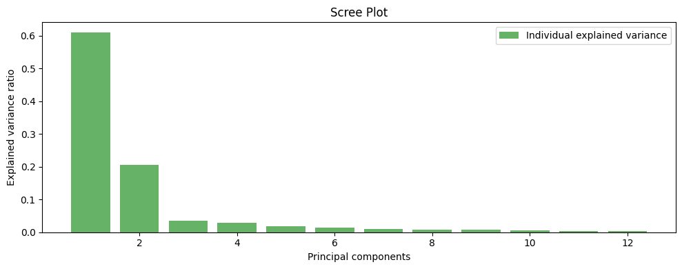
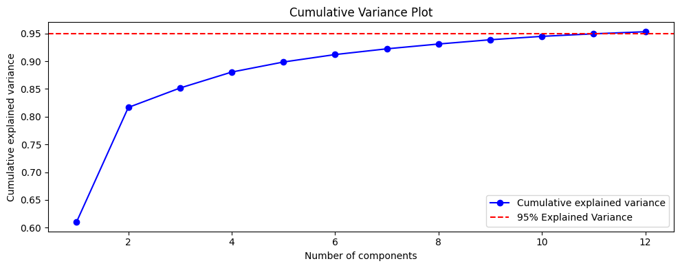
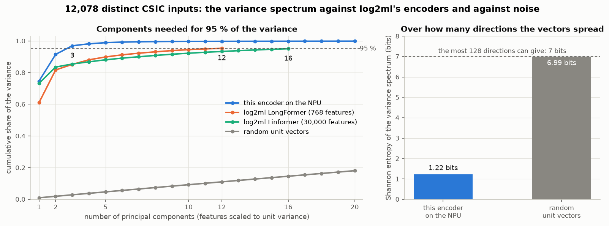
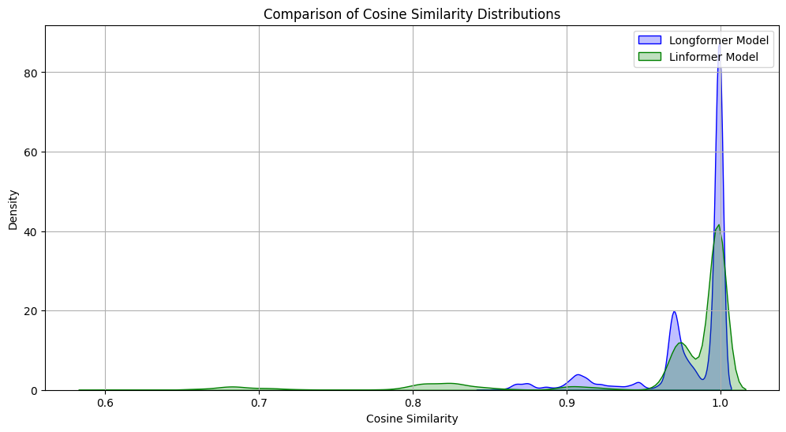
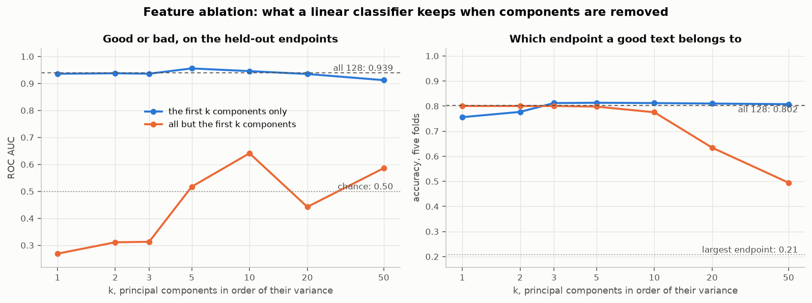

# Research log: why the encoder's vectors are one line, and what replaces it

2026-11-14. A log of one working day on the spec `npu-log-decision`: what was
measured, what it means, what the owner decided, and what would prove the
decision wrong. Structured with the COBESY composition method: the conclusion
first, the support in separate groups, the objections named, a disproof
condition stated. The measurements themselves are in
[the embedding qualification](2026-11-14-embedding-qualification.md); this log
does not repeat its tables.

## The conclusion

**The published encoder's vectors spread along one line, the good/bad score,
because the encoder was trained on the label alone. What else they keep of a log
line sits at an amplitude that distances do not see. The scorers that need
vectors wait.
A new encoder is sought that is hierarchical, reads the whole line and is
trained to keep what the line says.** The owner decided this on 2026-11-14; the
search is task 2.16, a gate like the one that found the problem.

## Where the day started

- **Situation.** The encoder session ran on the NPU (task 2.6). The plan was to
  build the decision part on its vectors: a neighbour scorer, a linear head and
  an outlier ranking (tasks 2.8, 2.10, 2.11), after Venn's Vector Decision Model.
- **Complication.** Nobody had looked at the vectors themselves. The owner made
  that a gate on 2026-11-13: if the vectors are noise whatever strings go in,
  nothing built on them is a proper ML implementation.
- **Question.** Are the vectors suitable, and do distinct features of a log line
  remain present in them?
- **Answer.** Not noise, but nearly one-dimensional. Suitable for a score, not
  for the rest.

## What was measured

Task 2.15, on the published model `csic-science-2.1-099570ec739c` in `payload`
mode, 12,078 distinct inputs of CSIC 2010 and 72 hand-written probe strings,
encoded on the NPU through the real session.

| Question | Finding |
|---|---|
| Different strings, different vectors? | Mostly: 12,079 inputs give 11,052 distinct vectors. But two random texts have a median cosine of 0.83; random unit vectors give 0.00. |
| Similar near, unrelated apart? | Near holds: one character changed gives 0.9994 to 0.9999. Apart holds only across the good/bad line: an attack against its benign request 0.38, two unrelated benign requests 0.87. |
| Structure by label and endpoint? | Yes: the 11 nearest texts share the label in 92 % of the cases (chance 52 %) and, among good texts, the endpoint in 80 % (chance 20 %). |
| How many dimensions carry the variance? | One holds 87.9 %, two hold 95.1 %, five hold 99.4 %. Participation ratio 1.3 of 128; random unit vectors 126.7. |

What that does to the three planned scorers, on the three endpoints the encoder
was not fitted on:

- **Linear head.** ROC AUC 0.939. The first principal component alone gives
  0.936, so the other 127 dimensions add almost nothing.
- **Neighbour scorer.** Every held-out good text has at least 9 bad texts among
  its 11 nearest stored texts.
- **Outlier ranking.** Not run. All 72 probes, random bytes included, have a
  CSIC vector at cosine 0.98 or more, so "far from everything" hardly occurs.

## Why it is so

Each string still becomes 128 numbers. They move together, so the points lie
almost on one line, and the place on the line is the good/bad score.

- **The cause is the training objective.** The model's training record names it:
  `bce-norm-unit`, a binary cross-entropy loss on the label. A network rewarded
  for one yes/no answer keeps that answer and discards the rest.
- **The science gate had seen the extreme case.** With the design's first
  objective (`bce`) it recorded 99.99 % of the variance in one direction. The
  published variant fixed the vector lengths for quantization. How many
  dimensions it uses was not measured then.
- **It is not the NPU, the session or a tokenizer.** Duplicates are
  bit-identical, the vector checksum (1570811.2676) equals that of tasks 2.12
  and 2.6, and there is no tokenizer: `ByteCodec` looks each of the first 256
  bytes up in a learned table of 256 rows by 64 channels.
- **Not excluded.** No float run was made, so quantization may add to the
  effect. The objective explains it without that.

Two losses of information come from the input step and are separate from the
collapse:

- **The cut at 256 bytes.** A `DROP TABLE` after byte 256 gives the same vector
  as the request without it.
- **Payload mode.** Method and path are not read. 1,634 CSIC texts with an empty
  payload share one vector, and so would any plain log line.

## The information view

The owner's chain of thought is Shannon's: if the vectors collapse, information
is lost; without information no ML decision is possible. A vector set has to be
qualified for classification, and the way to do it is to remove distinct
features and see what a classifier loses. Three measurements follow that chain.
They were added to the scripts as `q5_information.py`; the figures are in
`q5.log`.

### 1. Is an input still told apart? Mostly yes

- 12,078 distinct inputs give 11,051 distinct vectors: 13.43 of the 13.56 bits
  it would take to tell every input apart.
- What is lost outright is the **folding**: 381 vectors are shared by 1,408
  inputs (the examples seen differ only in digits), 1,634 texts with an empty
  payload share one vector, and nothing after byte 256 is read.

So the encoder does not map everything to one point. The loss is somewhere else.

### 2. How far do the vectors spread? Over about two directions

This is log2ml's own check, from its notebook `Comparison_of_Encoder_Models`:
scale every feature to unit variance, run PCA, count the components that hold
95 % of the variance. log2ml's charts for its LongFormer vectors:

The same check on this encoder, drawn beside log2ml's two encoders and beside
noise:

| Vectors | Components for 95 % of the variance | First component |
|---|---|---|
| This encoder on the NPU, 128 features | 3 (2 without the scaling) | 0.746 (0.879) |
| log2ml LongFormer, 768 features | 12 | 0.610 |
| log2ml Linformer, 30,000 features | 16 | 0.732 |
| Random unit vectors, 128 features | 121 | 0.009 |

The shares of the variance per component are a distribution, so they have a
Shannon entropy. For this encoder it is 1.22 bits (0.75 bits without the
scaling), an effective rank of 2.3 (1.7). 128 directions can give 7.00 bits;
random unit vectors give 6.99.

A limit on the comparison: log2ml's encoders are pretrained models that were not
trained on labels, and their logs are Sysmon events, not CSIC. The comparison is
of the method and of the scale, not of like with like. log2ml's vectors are
narrow too: its cosine similarities also crowd near 1.

### 3. What does a classifier lose when features are removed? It depends on the question

Feature ablation over the principal components, every retained component scaled
to unit variance, a logistic regression on top. Two questions: the one the
encoder was trained on (good or bad, tested on the three held-out endpoints) and
one it was not trained on (which of five endpoints a good text belongs to, five
folds).

| Components used | Good or bad, ROC AUC on held-out endpoints | Endpoint, accuracy |
|---|---|---|
| All 128 | 0.939 | 0.802 |
| The first only | 0.936 | 0.756 |
| All but the first | 0.269 | 0.801 |
| All but the first 5 | 0.517 | 0.798 |
| All but the first 50 | 0.586 | 0.495 |
| Random unit vectors, all 128 | 0.511 | 0.203 |

- **The label lives in the first few components.** The first alone gives what
  all 128 give. Without the first five the head is at chance.
- **The endpoint is spread over many components, most of them tiny.** Without
  the first five, which hold over 99 % of the variance, the head still names the
  endpoint in 80 % of the cases; the largest endpoint holds 21 %.
- **As a ratio of information:** for the endpoint the head recovers 0.81 of the
  2.32 bits of the endpoint's entropy. For the label on the held-out endpoints
  the ratio is negative (-0.57): the head ranks well, but its probabilities are
  wrong on endpoints it has not seen, so its cross-entropy is above the 0.93
  bits of the label's entropy.

What this says, in the owner's terms: the information about the content of a
line is not all gone. It is stored at an amplitude of under 1 % of the variance.
A fitted head can read it after rescaling. A distance cannot: the cosine
between two vectors is decided by the first component, and the neighbour scorer
and the outlier ranking work on distances. So the vector set qualifies for one
classification (good or bad, by one feature) and does not qualify as the basis
of the Venn part, which needs the distinct features to be visible in the
geometry. The 8-bit output also leaves little room at that amplitude; how much
was not measured.

## What was discussed

- **Meta's Byte Latent Transformer.** It reads raw bytes, cuts them into patches
  where a small next-byte model is surprised, runs a large model over the
  patches, and is trained on next-byte prediction without labels.
- **What carries over.** The objective: predicting bytes forces a model to keep
  the content. The patching: a long line becomes a few dozen patches instead of
  being cut.
- **What does not carry over as it is.** The NPU path runs fixed-shape 8-bit
  convolutional graphs. Patch boundaries that depend on the input are variable
  shapes, and whether attention layers compile through the Vitis provider is
  unchecked.
- **How a hierarchy fits the NPU anyway.** Byte features from one fixed-shape
  graph; pooling of those features into patches between two graphs, as plain
  arithmetic; a second fixed-shape graph over the patches. The entropy model is
  a small causal convolution in the same layout.
- **The reference code.** https://github.com/facebookresearch/blt holds the
  paper's code (`bytelatent`), an entropy model (`facebook/blt-entropy`) and
  weights of 1 and 7 billion parameters, tested by its authors on H100 GPUs.
  Only its README was read here. Those models are far too large for the NPU;
  what the spike takes from it is the method of entropy patching.
- **Folding.** The owner expects the byte latent approach to resolve the folding
  problem to some extent. Of its three causes, two go away by construction: a
  line that is patched is not cut at 256 bytes, and the whole line is read, not
  the payload alone. The third, inputs that differ only in digits and get one
  vector, is expected to shrink: next-byte prediction makes digits matter, and
  unpredictable values get patches of their own. It is not excluded that
  pooling a line into one 8-bit vector still folds some inputs. The gate counts
  it: distinct vectors per distinct input, and inputs that share a vector.

## What the owner decided

1. **The convolutional architecture stays.** The owner calls it semi-ideal for
   string encoding.
2. **Hierarchies are key.** Bytes, then patches, then the line.
3. **Patches are dynamic and entropy-based,** after the Byte Latent Transformer.
   The owner's reason: log text is not like a novel or a set of natural-language
   strings.
4. **No cutting.** Cutting a line loses information.
5. **One vector per log line.** The store keeps its shape.
6. **A gate task is written and started** (2.16). Tasks 2.8, 2.10 and 2.11 wait
   for its result. Task 2.7 (encode and store) does not depend on the model and
   can go ahead.

## The objections, and how they are handled

- **"Delimiters give the same cut for free."** On structured logs the entropy
  jumps may fall on `&`, `=`, `/` and spaces. So task 2.16 trains three ways to
  cut under the same objective: fixed stride, delimiters, entropy. Entropy
  patching has to beat the two controls in a measurement.
- **"A new log source changes the patching."** Where the entropy model has seen
  nothing alike, everything is surprising and patches become short. Task 2.16
  reports the patching on a sample of the AIT logs against CSIC.
- **"A hierarchy alone does not fix the collapse."** Correct: with a label-only
  loss a hierarchical model learns one direction too. The fix is the objective.
  One variant is trained without the label.
- **"Three passes cost speed."** Measured today with one pass: 16,000 to 42,000
  logs per second. Required: 1,000. The figure for the new layout is not known
  and is part of the gate.

## We are wrong if

- the best variant of task 2.16 still puts most of its variance into a few
  directions, or keeps unrelated lines near each other;
- its feature ablation looks like today's: the content of a line readable only
  from components that hold almost none of the variance;
- it still folds inputs that differ, beyond what its stated longest line
  explains;
- entropy patching does not beat fixed stride and delimiter patches on the gate's
  measurements;
- the two-stage layout does not compile on the NPU, gets rows wrong, or falls
  below 1,000 logs per second;
- vectors that keep the content rank attacks clearly worse than the baseline
  scorer on held-out endpoints, so that keeping content costs the triage
  quality the tool exists for.

Any of these goes to the owner before a scorer is built on the new vectors.

## Open questions

- What is the longest line the new encoder handles without cutting, and how
  often is it exceeded on CSIC and on the AIT logs?
- Which self-supervised objective at the patch level: masked-patch prediction or
  a contrastive loss?
- Does 8-bit quantization narrow the vectors by itself? Task 2.16 qualifies float
  and 8-bit vectors side by side.
- What must change in `EncoderPackage`, `ByteCodec` and `EncoderSession`, and in
  requirements 1.5 and 4? The spec is amended only after the owner has decided
  on the gate's result.

## Where things are recorded

| What | Where |
|---|---|
| The measurements, pictures and limits | `docs/2026-11-14-embedding-qualification.md`, logs in `D:\BuildArtifacts\log2decision\task-2.15\logs\` |
| The information view: spectrum, entropy, ablation | `tools/embedding-qualification/q5_information.py`, log `D:\BuildArtifacts\log2decision\task-2.15\logs\q5.log` |
| log2ml's charts and figures | `log2ml/2-3-2-open-source-deep-learning-models-for-encoding-taks/Comparison_of_Encoder_Models.ipynb`, cells 41, 44, 45 and 48 |
| The scripts, to qualify any later encoder | `tools/embedding-qualification/` |
| The gate task that follows | task 2.16 in `.kiro/specs/npu-log-decision/tasks.md` |
| The earlier one-dimensional finding | `docs/2026-11-12-science-gate-encoder.md`, objective `bce` |
